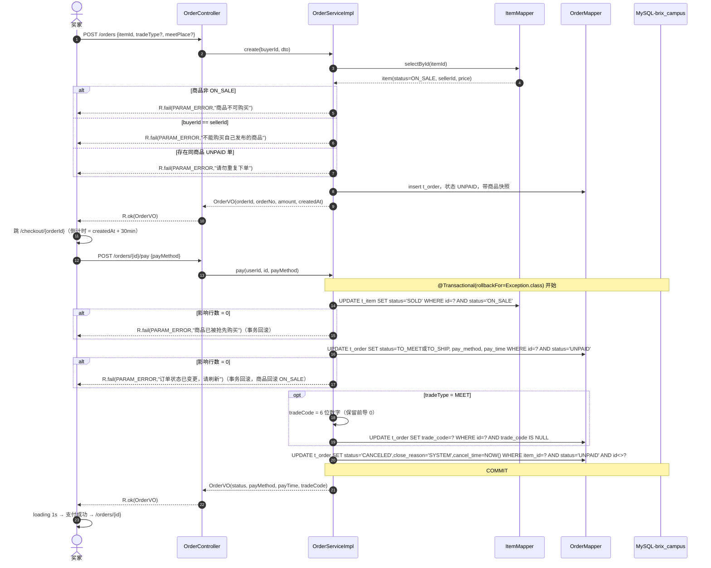
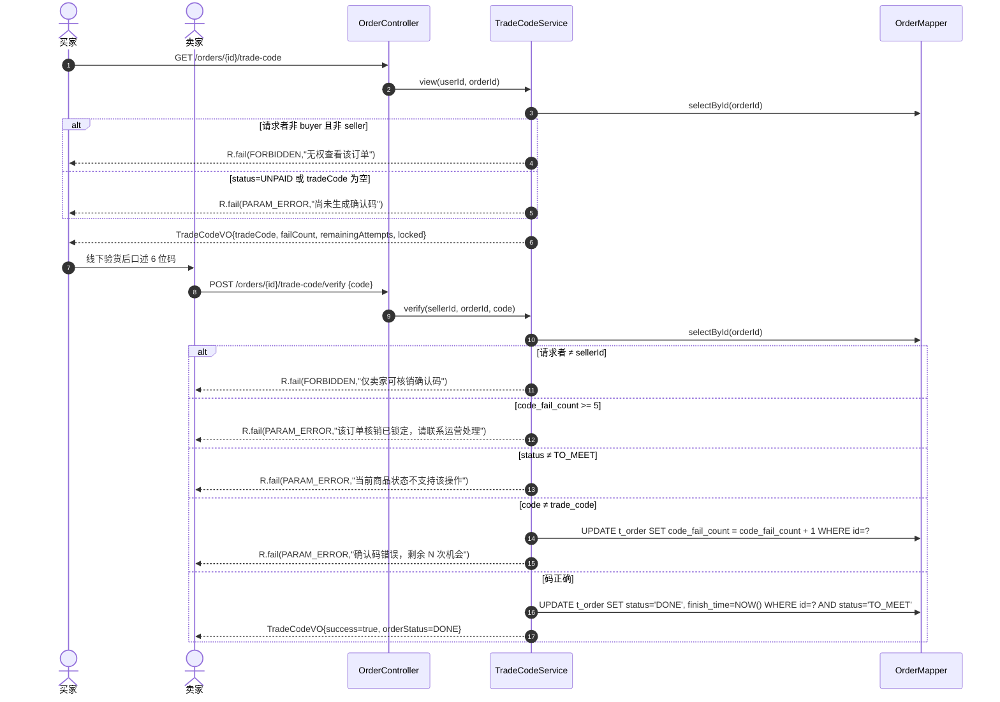
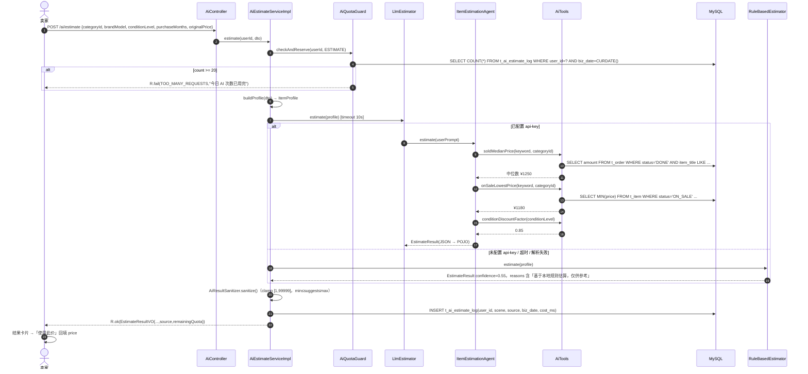

# Brix Campus Market 系统架构设计（ARCHITECTURE）

> 版本：**v2.0（按《SpringBoot + Vue3 项目指导书》工程规范重写）** ｜ 上游输入：`docs/PRD.md`（v1.0，69 条需求 / 19 页 / 11 表 / 55 个接口位）
> 本文是**契约级文档**：只给表结构、接口签名、类契约、配置片段、任务顺序，不写业务实现代码。工程师照此直接落地。
> 语言：中文注释与中文提示文案；标识符英文 camelCase。

## 0. 规范对齐清单（v2.0 相对 v1.0 的 12 处覆盖，逐条可核）

| # | 规范项 | v2.0 决策 | 落地位置 |
| --- | --- | --- | --- |
| 1 | 版本 | SpringBoot **3.5.3**、MP **3.5.17** + `mybatis-plus-jsqlparser-4.9`、Druid **1.2.28**、编译 `--release 17`、`<parameters>true</parameters>` | 1.1、11.5 |
| 2 | 依赖管理 | `dependencyManagement` import `spring-boot-dependencies:3.5.3`，**不继承 parent** | 1.2 |
| 3 | 响应体 | `R<T>{code,msg,data,timestamp}`；`ResultCode` 枚举；`BusinessException` 异常流；**业务失败 HTTP 仍 200** | 5.1、5.2 |
| 4 | 表名 | 全部 `t_` 前缀（`order` 保留字问题一并解决）；`table-prefix: t_` | 3.1 |
| 5 | 包结构 | `common / config / model / model.query / model.dto / model.vo / mapper / service(+impl) / controller / security / ai / ws / job / util` | 2.1 |
| 6 | 分层 | Controller 不写业务、Service 不返 R、Mapper 不写业务；`@Validated` 类注解 + `@PathVariable("id")` 显式命名 | 2.2 |
| 7 | 分页 | `currentPage`/`pageSize`，返回 MP `IPage<T>`，**必须显式 orderBy** | 5.4 |
| 8 | ID 精度 | `MpConfig` 注册 `Long → ToStringSerializer`，**所有 id 到前端是 string** | 5.5 |
| 9 | 前端目录 | `views/`（非 pages/）+ `constants/` + `UserCenterLayout`，路由 `createWebHashHistory` | 8.1 |
| 10 | 前端请求 | `utils/request.js` 唯一实例，`code===200` 判成功，`skipErrorTip`，四类错误分支 | 8.4 |
| 11 | 前端铁律 | props 不改 + 弹窗副本刷新 + 编辑先取详情；分页三条细节 | 8.6 |
| 12 | 本地启动 | **只做开发态双进程**（后端 8080 + 前端 5173 Vite 代理）+ 3 个本地启动脚本；**不做打包、不做部署、不写 Nginx/Tomcat** | 11 |

---

## 1. 技术选型与版本对齐

### 1.1 版本矩阵（与指导书 1.3.1 一致，改动即视为破坏契约）

| 组件 | 版本 | 说明 |
| --- | --- | --- |
| JDK（运行） | 24（本机实测 `java version "24"`） | 仅运行环境 |
| JDK（编译） | `--release 17` | `maven-compiler-plugin` 配 `<release>17</release>` + `<parameters>true</parameters>` |
| Spring Boot | **3.5.3** | `spring-boot-dependencies` 3.5.3（import，不继承 parent） |
| Spring Security | 随 Boot 3.5.3（6.5.x） | `SecurityFilterChain` 写法，无 `WebSecurityConfigurerAdapter` |
| MyBatis-Plus | **3.5.17** | starter：`mybatis-plus-spring-boot3-starter` |
| MP JSqlParser | **`mybatis-plus-jsqlparser-4.9` 3.5.17** | **必须显式引入**：3.5.9+ 起 `PaginationInnerInterceptor` 依赖被置 optional，不引会编译期「找不到符号」 |
| Druid | **1.2.28** | starter：`druid-spring-boot-3-starter`（Boot3 专用），前缀 `spring.datasource.druid` |
| MySQL Server | 9.6（服务名 MySQL80，3306） | 认证插件 `caching_sha2_password` |
| mysql-connector-j | **9.2.0** | 官方支持 MySQL 9.x；本机 `.m2` 已缓存 |
| JJWT | 0.12.6（api / impl / jackson） | 新 API：`Jwts.builder().signWith(key)` |
| LangChain4j | 1.22.0（`langchain4j` + `langchain4j-open-ai`） | 用稳定线，手工装配 `AiServices`（见 1.3） |
| Lombok | 1.18.48 | **必须 ≥1.18.38**，否则 JDK 24 下注解处理器报 `ExceptionInInitializerError` |
| Vue | 3.5.44 | `<script setup>` |
| vue-router | 4.5.1 | **`createWebHashHistory`**（hash 路由，无需服务端 history 配置） |
| Pinia | 3.0.3 | 仅 `auth` store |
| Element Plus | 2.11.4（+ `@element-plus/icons-vue` 2.3.2） | 中文 locale |
| Axios | 1.12.2 | 唯一实例 `utils/request.js` |
| ECharts | 5.6.0 | 折线 + 饼图 |
| dayjs | 1.11.18 | 格式化与倒计时 |
| Vite | 7.1.5（`@vitejs/plugin-vue` 6.0.1） | Node 22.22.2 ✅ |
| TypeScript | 5.9.2 | 只用于 `router/`、`stores/`、`vite.config.ts`；`build` 只跑 `vite build` |

### 1.2 `pom.xml` 骨架（契约，照抄结构）

```xml
<project>
  <modelVersion>4.0.0</modelVersion>
  <groupId>com.brix</groupId>
  <artifactId>brix-campus-market</artifactId>
  <version>1.0.0</version>
  <packaging>jar</packaging>

  <properties>
    <java.version>17</java.version>
    <maven.compiler.release>17</maven.compiler.release>
    <project.build.sourceEncoding>UTF-8</project.build.sourceEncoding>
    <spring-boot.version>3.5.3</spring-boot.version>
    <mybatis-plus.version>3.5.17</mybatis-plus.version>
    <druid.version>1.2.28</druid.version>
    <jjwt.version>0.12.6</jjwt.version>
    <langchain4j.version>1.22.0</langchain4j.version>
    <lombok.version>1.18.48</lombok.version>
  </properties>

  <!-- 关键：import BOM，不继承 spring-boot-starter-parent -->
  <dependencyManagement>
    <dependencies>
      <dependency>
        <groupId>org.springframework.boot</groupId>
        <artifactId>spring-boot-dependencies</artifactId>
        <version>${spring-boot.version}</version>
        <type>pom</type><scope>import</scope>
      </dependency>
    </dependencies>
  </dependencyManagement>

  <dependencies>
    <!-- web / security / validation / websocket / aop -->
    <!-- org.springframework.boot:spring-boot-starter-{web,security,validation,websocket} -->
    <!-- com.baomidou:mybatis-plus-spring-boot3-starter:${mybatis-plus.version} -->
    <!-- com.baomidou:mybatis-plus-jsqlparser-4.9:${mybatis-plus.version}   ← 不可省 -->
    <!-- com.alibaba:druid-spring-boot-3-starter:${druid.version} -->
    <!-- com.mysql:mysql-connector-j:9.2.0 (runtime) -->
    <!-- io.jsonwebtoken:{jjwt-api,jjwt-impl(runtime),jjwt-jackson(runtime)}:${jjwt.version} -->
    <!-- dev.langchain4j:{langchain4j,langchain4j-open-ai}:${langchain4j.version} -->
    <!-- org.projectlombok:lombok:${lombok.version} (provided) -->
    <!-- org.springframework.boot:spring-boot-starter-test (test) -->
  </dependencies>

  <build>
    <plugins>
      <plugin>
        <artifactId>maven-compiler-plugin</artifactId>
        <configuration>
          <release>17</release>
          <parameters>true</parameters>      <!-- @PathVariable / @RequestParam 免写 name -->
          <annotationProcessorPaths>
            <path><groupId>org.projectlombok</groupId><artifactId>lombok</artifactId>
                  <version>${lombok.version}</version></path>
          </annotationProcessorPaths>
        </configuration>
      </plugin>
      <plugin>
        <groupId>org.springframework.boot</groupId>
        <artifactId>spring-boot-maven-plugin</artifactId>
        <version>${spring-boot.version}</version>
      </plugin>
    </plugins>
  </build>
</project>
```

> 校验注解统一 `jakarta.validation.constraints.*`；`@Valid`/`@Validated` 用 `jakarta.validation.*` 与 `org.springframework.validation.annotation.Validated`。**任何 `javax.*` 引用都是错的**（Boot3 不认）。

### 1.3 关于 LangChain4j 不用 starter 的说明

Maven Central 上 `langchain4j-spring-boot-starter` 目前只有 `1.x-betaNN` 线（最新 `1.22.0-beta32`），而核心 `langchain4j`/`langchain4j-open-ai` 已是稳定 1.22.0。本项目必须做「有 Key 走 LLM / 无 Key 走规则」Bean 级条件装配（J03），starter 自动装配反而要额外屏蔽。故：**只用稳定核心包 + `ai/AiConfig` 手工装配**，功能等价、无 beta 依赖、无 Key 时启动零报错（详见 6.3、13-R3）。

---

## 2. 包结构与分层约束

### 2.1 目录树（文件级）

```text
brix-campus-market/
├── db/
│   ├── schema.sql                 # 建库 + 11 张 t_ 表（附录 A）
│   ├── data.sql                   # 种子数据（附录 B：8 用户 / 6 分类 / 36 商品 / 订单 / 评价 / 私信）
│   └── init-db.bat                # 交互输入 root 密码 → 建库建号 → 导入 schema/data
├── backend/
│   ├── pom.xml
│   ├── uploads/                   # 运行期生成（.gitignore）
│   └── src/
│       ├── main/java/com/brix/campus/
│       │   ├── BrixCampusApplication.java      # 必须在根包，否则子包漏扫
│       │   ├── common/
│       │   │   ├── R.java                      # {code,msg,data,timestamp}
│       │   │   ├── ResultCode.java             # 枚举，唯一 code 来源
│       │   │   ├── BusinessException.java      # RuntimeException + ResultCode
│       │   │   ├── GlobalExceptionHandler.java # @RestControllerAdvice（业务异常 HTTP 200）
│       │   │   └── （分页统一用 MP IPage，不自造 PageResult）
│       │   ├── common/validation/
│       │   │   └── ValidGroup.java             # interface Save / Update
│       │   ├── config/
│       │   │   ├── MpConfig.java               # 分页插件 + Long→String + MapperScan
│       │   │   ├── CorsConfig.java             # 开发态跨域（5173 → 8080）
│       │   │   ├── WebMvcConfig.java           # /uploads/** 静态映射
│       │   │   ├── SecurityConfig.java         # SecurityFilterChain + BCryptPasswordEncoder
│       │   │   ├── WebSocketConfig.java        # ServerEndpointExporter
│       │   │   ├── AiConfig.java               # ChatModel + AiServices 条件装配
│       │   │   ├── JacksonConfig.java          # LocalDateTime yyyy-MM-dd HH:mm:ss
│       │   │   └── ScheduleConfig.java         # 任务线程池
│       │   ├── model/
│       │   │   ├── BaseEntity.java             # id / createdAt / updatedAt / deleted
│       │   │   ├── User.java  Category.java  Item.java  ItemImage.java  Favorite.java
│       │   │   ├── ItemComment.java  Order.java  Review.java  Report.java
│       │   │   ├── ChatMessage.java  AiEstimateLog.java
│       │   │   └── enums/                      # RoleEnum/UserStatusEnum/ItemStatusEnum/ConditionEnum/
│       │   │                                   # TradeTypeEnum/OrderStatusEnum/PayMethodEnum/ReportReasonEnum/
│       │   │                                   # ReportStatusEnum/HandleActionEnum/CloseReasonEnum/AiSceneEnum
│       │   ├── model/query/
│       │   │   ├── BaseQuery.java              # currentPage/pageSize(@Max 50)/offset()
│       │   │   ├── ItemQuery.java  OrderQuery.java  UserQuery.java  ChatQuery.java
│       │   │   └── CommentQuery.java  ReportQuery.java  ItemAuditQuery.java
│       │   ├── model/dto/                      # 请求 DTO（见 2.3 清单）
│       │   ├── model/vo/                       # 响应 VO（见 2.3 清单）
│       │   ├── mapper/                         # 11 个 Mapper extends BaseMapper<T>
│       │   ├── service/  +  service/impl/      # 14 对接口/实现
│       │   ├── controller/                     # 12 个用户端
│       │   ├── controller/admin/               # 7 个后台
│       │   ├── security/
│       │   │   ├── JwtUtil.java  JwtAuthFilter.java  LoginUser.java
│       │   │   ├── UserDetailsServiceImpl.java
│       │   │   ├── RestAuthenticationEntryPoint.java  RestAccessDeniedHandler.java
│       │   │   └── SecurityUtils.java
│       │   ├── ai/                             # 见 6.2
│       │   ├── ws/
│       │   │   ├── ChatWebSocketHandler.java   # @ServerEndpoint("/ws/chat")
│       │   │   ├── WsSessionManager.java  WsMessage.java  WsMessageType.java
│       │   ├── job/
│       │   │   └── OrderTimeoutJob.java
│       │   └── util/
│       │       ├── OrderNoGenerator.java  TradeCodeGenerator.java
│       │       ├── ViewCountDedupCache.java  FileUtils.java
│       └── main/resources/
│           ├── application.yml
│           ├── application-dev.yml             # 可选：本地覆盖
│           └── mapper/                         # 仅复杂联表查询才写 XML
│               ├── ItemMapper.xml  OrderMapper.xml
│               ├── ChatMessageMapper.xml  ReportMapper.xml  UserMapper.xml
│       └── test/java/com/brix/campus/
│           ├── OrderPayTransactionTest.java
│           ├── TradeCodeLockTest.java
│           ├── ItemStatusMachineTest.java
│           └── PermissionBoundaryTest.java
├── frontend/                       # 见第 8 节
├── start-backend.bat               # 本地启动后端（自动定位 Maven）
├── start-frontend.bat              # 本地启动前端
├── .env.example  README.md
```

### 2.2 分层职责（硬边界，Code Review 逐条对照）

| 层 | 可以做 | 禁止做 |
| --- | --- | --- |
| Controller | 路由映射、`@Validated`/`@Valid`、取 `SecurityUtils.currentUserId()`、调 Service、封装 `R` | 写 if 业务判断、直接调 Mapper、拼 SQL、返回 Entity |
| Service（接口） | 显式声明业务方法，出入参用 DTO/Query/VO/Entity | 依赖 `HttpServletRequest`、返回 `R` |
| ServiceImpl | 业务规则、存在性校验、抛 `BusinessException`、日志、`@Transactional(rollbackFor = Exception.class)`；单表 CRUD 继承 `ServiceImpl<Mapper, Entity>` | 关心 HTTP、`new R<>()` |
| Mapper | 单表用 `BaseMapper<T>`（**不写 XML**）；只有需 join/聚合的查询才写 XML 方法 | 写业务判断、跨表写操作 |
| model | `@TableName`（靠 table-prefix 自动映射时省略）、`@TableLogic`、`@TableField(fill=...)` | 展示逻辑、业务方法 |
| model.query | 分页查询条件对象（`currentPage`/`pageSize` + 筛选字段），**绝不复用实体当查询条件** | 含 `@TableName` |
| model.dto / model.vo | 入参/出参载体，`@NotBlank(message=...)` 等校验注解只在 dto | 持久化注解 |

**必须记住的两条注解规则**
1. `@Validated` 加在 **Controller 类上**，`@PathVariable` / `@RequestParam` 上的 `@Min(1)`、`@NotBlank` 才生效（方法级 `@Valid` 只管请求体）。
2. 路径变量一律显式命名：`@PathVariable("id") Long id`（虽然开了 `<parameters>`，显式命名可防 IDE/字节码差异导致取参失败）。

**事务边界三个唯一入口**（其它方法不加 `@Transactional`）：
1. `OrderServiceImpl.pay()` — 抢占商品 + 订单状态 + `pay_time`/`pay_method` + 关闭同商品其它 UNPAID + 生成面交码（E02/E10/F01）；
2. `OrderServiceImpl.cancel()` — 订单 CANCELED + 商品回滚 ON_SALE（E05）；
3. `ReviewServiceImpl.create()` — 写评价 + 卖家信用分增减（G01/G03）。

### 2.3 DTO / VO 清单（文件名即类名）

**model/dto**（请求）：`RegisterDTO`、`LoginDTO`、`UpdateProfileDTO`、`ChangePasswordDTO`、`ItemSaveDTO`、`ItemStatusDTO`、`OrderCreateDTO`、`PayDTO`、`CancelOrderDTO`、`TradeCodeVerifyDTO`、`CommentCreateDTO`、`ReviewCreateDTO`、`ReportCreateDTO`、`ReportHandleDTO`、`BatchAuditDTO`、`AuditRejectDTO`、`OfflineDTO`、`CategorySaveDTO`、`UserStatusDTO`、`ChatSendDTO`、`AiEstimateDTO`、`AiCopyDTO`。

**model/vo**（响应）：`UserVO`、`LoginVO`、`MenuVO`、`UserStatsVO`、`ItemVO`、`ItemDetailVO`、`ItemImageVO`、`SellerVO`、`CategoryVO`、`FavoriteVO`、`CommentVO`、`OrderVO`、`OrderDetailVO`、`TradeCodeVO`、`ReviewVO`、`ReviewSummaryVO`、`ReportVO`、`ConversationVO`、`ChatMessageVO`、`EstimateResultVO`、`CopyResultVO`、`UploadVO`、`DashboardOverviewVO`、`TrendPointVO`、`CategoryDistributionVO`、`AdminUserVO`、`AdminItemVO`、`AdminOrderVO`。

---

## 3. 数据库设计（11 张表，全部 `t_` 前缀）

### 3.1 表名映射（PRD 逻辑名 → 物理表名）

`mybatis-plus.global-config.db-config.table-prefix: t_` + `id-type: auto`：类名 `User` → `t_user`（驼峰转下划线后加前缀）。这样既统一规范，也**顺手解决了 `order` 是 MySQL 保留字**的坑。

| PRD 名称 | 物理表 | 实体类 | Mapper |
| --- | --- | --- | --- |
| users | `t_user` | `User` | `UserMapper` |
| categories | `t_category` | `Category` | `CategoryMapper` |
| items | `t_item` | `Item` | `ItemMapper` |
| item_images | `t_item_image` | `ItemImage` | `ItemImageMapper` |
| favorites | `t_favorite` | `Favorite` | `FavoriteMapper` |
| item_comments | `t_item_comment` | `ItemComment` | `ItemCommentMapper` |
| orders | `t_order` | `Order` | `OrderMapper` |
| reviews | `t_review` | `Review` | `ReviewMapper` |
| reports | `t_report` | `Report` | `ReportMapper` |
| chat_messages | `t_chat_message` | `ChatMessage` | `ChatMessageMapper` |
| ai_estimate_logs | `t_ai_estimate_log` | `AiEstimateLog` | `AiEstimateLogMapper` |

通用约定：主键 `id BIGINT UNSIGNED AUTO_INCREMENT`；审计 `created_at`/`updated_at`（`DATETIME`，由 `MetaObjectHandler` 填充）；逻辑删除 `deleted TINYINT NOT NULL DEFAULT 0`；枚举全部 `VARCHAR` 存业务码（不用 tinyint）。完整 DDL 见**附录 A**。

### 3.2 `t_user` 用户表

| 字段 | 类型 | 可空 | 默认 | 说明 |
| --- | --- | --- | --- | --- |
| id | BIGINT UNSIGNED | 否 | auto | 主键 |
| username | VARCHAR(50) | 否 | - | 登录名，唯一 |
| password | VARCHAR(100) | 否 | - | BCrypt `$2a$` 密文（N04） |
| nickname | VARCHAR(50) | 否 | - | 昵称 |
| avatar | VARCHAR(255) | 否 | '' | 头像 URL |
| school | VARCHAR(100) | 是 | NULL | 学校 |
| campus | VARCHAR(50) | 是 | NULL | 校区（筛选 + 面交地点基准） |
| phone | VARCHAR(20) | 是 | NULL | 11 位数字 |
| bio | VARCHAR(255) | 否 | '' | 简介 |
| role | VARCHAR(20) | 否 | 'USER' | `USER`/`REVIEWER`/`OPERATOR` |
| status | VARCHAR(20) | 否 | 'NORMAL' | `NORMAL`/`DISABLED` |
| credit_score | INT | 否 | 100 | 业务层 clamp [0,200] |
| disabled_by | BIGINT UNSIGNED | 是 | NULL | 操作人（K06） |
| disabled_at | DATETIME | 是 | NULL | 操作时间（K06） |
| deleted / created_at / updated_at | - | - | - | 审计 |

索引：`UNIQUE uk_username(username)`、`KEY idx_role_status(role,status)`、`KEY idx_campus(campus)`、`KEY idx_nickname(nickname)`。
> 逻辑删除 + `uk_username` 的冲突（删号后用户名仍占用）本期无注销需求，接受（13-R8）。

### 3.3 `t_category` 分类表

| 字段 | 类型 | 可空 | 默认 | 说明 |
| --- | --- | --- | --- | --- |
| id | BIGINT UNSIGNED | 否 | auto | 主键 |
| name | VARCHAR(30) | 否 | - | 唯一（K12 校验重名） |
| icon | VARCHAR(50) | 否 | '' | 图标名 |
| sort | INT | 否 | 0 | 升序（B09） |
| deleted / created_at / updated_at | - | - | - | 审计 |

索引：`UNIQUE uk_name(name)`、`KEY idx_sort(sort)`。

### 3.4 `t_item` 商品表

| 字段 | 类型 | 可空 | 默认 | 说明 |
| --- | --- | --- | --- | --- |
| id | BIGINT UNSIGNED | 否 | auto | 主键 |
| title | VARCHAR(40) | 否 | - | ≤40 字 |
| description | VARCHAR(2000) | 否 | '' | ≤2000 字 |
| category_id | BIGINT UNSIGNED | 否 | - | 分类 |
| price | DECIMAL(10,2) | 否 | - | `0 < price ≤ 99999.99` |
| original_price | DECIMAL(10,2) | 是 | NULL | 填写时 ≥ price |
| condition_level | VARCHAR(20) | 否 | - | `BRAND_NEW`/`LIKE_NEW`/`LIGHT_USE`/`HEAVY_USE` |
| campus | VARCHAR(50) | 否 | - | 校区 |
| trade_type | VARCHAR(10) | 否 | - | `MEET`/`SHIP`/`BOTH` |
| contact | VARCHAR(50) | 是 | NULL | 联系方式 |
| status | VARCHAR(20) | 否 | 'PENDING' | `PENDING`/`ON_SALE`/`OFF_SHELF`/`SOLD`/`REJECTED` |
| cover_image | VARCHAR(255) | 否 | '' | 首图（与 `t_item_image.sort` 最小同步） |
| view_count | INT | 否 | 0 | 浏览量（10 分钟去重） |
| favorite_count | INT | 否 | 0 | 收藏数 |
| reject_reason | VARCHAR(200) | 是 | NULL | 审核拒绝原因 |
| seller_id | BIGINT UNSIGNED | 否 | - | 卖家 |
| audited_by | BIGINT UNSIGNED | 是 | NULL | 审核人 |
| audited_at | DATETIME | 是 | NULL | 审核时间 |
| deleted / created_at / updated_at | - | - | - | 审计 |

索引：`KEY idx_status_created(status, created_at)`、`KEY idx_category(category_id, status)`、`KEY idx_seller(seller_id, status)`、`KEY idx_campus_status(campus, status)`、`KEY idx_price(price)`。

### 3.5 `t_item_image` 商品图片表

| 字段 | 类型 | 可空 | 默认 | 说明 |
| --- | --- | --- | --- | --- |
| id | BIGINT UNSIGNED | 否 | auto | 主键 |
| item_id | BIGINT UNSIGNED | 否 | - | 商品 |
| url | VARCHAR(255) | 否 | - | `/uploads/item/202610/{uuid}.jpg` |
| sort | INT | 否 | 0 | 0 为首图，≤9 张 |
| created_at | DATETIME | 否 | CURRENT_TIMESTAMP | - |

索引：`KEY idx_item_sort(item_id, sort)`。编辑时整组物理替换（不需要逻辑删除）。

### 3.6 `t_favorite` 收藏表

| 字段 | 类型 | 可空 | 默认 | 说明 |
| --- | --- | --- | --- | --- |
| id | BIGINT UNSIGNED | 否 | auto | 主键 |
| user_id | BIGINT UNSIGNED | 否 | - | 收藏人 |
| item_id | BIGINT UNSIGNED | 否 | - | 商品 |
| created_at | DATETIME | 否 | CURRENT_TIMESTAMP | 收藏时间 |

索引：`UNIQUE uk_user_item(user_id, item_id)`（C01 唯一性兜底）、`KEY idx_item(item_id)`。取消收藏用**物理删除**，否则唯一索引会挡住再次收藏。

### 3.7 `t_item_comment` 留言表

| 字段 | 类型 | 可空 | 默认 | 说明 |
| --- | --- | --- | --- | --- |
| id | BIGINT UNSIGNED | 否 | auto | 主键 |
| item_id | BIGINT UNSIGNED | 否 | - | 商品 |
| user_id | BIGINT UNSIGNED | 否 | - | 留言人 |
| parent_id | BIGINT UNSIGNED | 是 | NULL | 空=一级；非空=回复（仅一层） |
| content | VARCHAR(500) | 否 | - | 1~500 字 |
| deleted / created_at / updated_at | - | - | - | 删一级留言时其回复一并置 1 |

索引：`KEY idx_item_parent(item_id, parent_id, created_at)`、`KEY idx_user(user_id)`。

### 3.8 `t_order` 订单表（核心）

| 字段 | 类型 | 可空 | 默认 | 说明 |
| --- | --- | --- | --- | --- |
| id | BIGINT UNSIGNED | 否 | auto | 主键 |
| order_no | VARCHAR(32) | 否 | - | `yyyyMMddHHmmss` + 6 位随机，唯一 |
| item_id | BIGINT UNSIGNED | 否 | - | 商品 |
| buyer_id / seller_id | BIGINT UNSIGNED | 否 | - | 买卖双方（卖家冗余，省连表判权） |
| amount | DECIMAL(10,2) | 否 | - | 成交金额 |
| item_title | VARCHAR(40) | 否 | - | 商品快照-标题 |
| item_cover | VARCHAR(255) | 否 | '' | 商品快照-首图 |
| item_price | DECIMAL(10,2) | 否 | - | 商品快照-单价 |
| trade_type | VARCHAR(10) | 否 | - | 实际成交：`MEET`/`SHIP`（BOTH 商品由买家下单时二选一） |
| status | VARCHAR(20) | 否 | 'UNPAID' | `UNPAID`/`TO_SHIP`/`TO_RECEIVE`/`TO_MEET`/`DONE`/`CANCELED` |
| pay_method | VARCHAR(10) | 是 | NULL | `WECHAT`/`ALIPAY`/`BANK` |
| pay_time / ship_time / finish_time / cancel_time | DATETIME | 是 | NULL | 时间线（E09） |
| close_reason | VARCHAR(20) | 是 | NULL | `TIMEOUT`/`BUYER_CANCEL`/`SELLER_CANCEL`/`SYSTEM` |
| trade_code | CHAR(6) | 是 | NULL | 面交 6 位码（含前导 0） |
| code_fail_count | INT | 否 | 0 | 核销失败次数，**持久化**（F04 重启仍锁定） |
| meet_place | VARCHAR(100) | 是 | NULL | 面交地点（校区+宿舍楼） |
| buyer_note | VARCHAR(200) | 是 | NULL | 买家备注（邮寄收货信息占位，PRD 待确认 #3） |
| deleted / created_at / updated_at | - | - | - | 定时任务按 `created_at` 判超时 |

索引：`UNIQUE uk_order_no(order_no)`、`KEY idx_buyer(buyer_id,status,created_at)`、`KEY idx_seller(seller_id,status,created_at)`、`KEY idx_item_status(item_id,status)`、`KEY idx_status_created(status,created_at)`。

### 3.9 `t_review` 评价表

| 字段 | 类型 | 可空 | 默认 | 说明 |
| --- | --- | --- | --- | --- |
| id | BIGINT UNSIGNED | 否 | auto | 主键 |
| order_id | BIGINT UNSIGNED | 否 | - | **唯一**（每单一条兜底） |
| item_id | BIGINT UNSIGNED | 否 | - | 商品（展示） |
| buyer_id / seller_id | BIGINT UNSIGNED | 否 | - | 评价人 / 被评人 |
| rating | TINYINT | 否 | - | 1~5 |
| content | VARCHAR(500) | 否 | '' | 0~500 字 |
| images | VARCHAR(1000) | 否 | '' | 图片 URL 的 JSON 数组（0~3 张） |
| created_at | DATETIME | 否 | CURRENT_TIMESTAMP | - |

索引：`UNIQUE uk_order(order_id)`、`KEY idx_seller(seller_id, created_at)`。

### 3.10 `t_report` 举报表

| 字段 | 类型 | 可空 | 默认 | 说明 |
| --- | --- | --- | --- | --- |
| id | BIGINT UNSIGNED | 否 | auto | 主键 |
| item_id / reporter_id | BIGINT UNSIGNED | 否 | - | 商品 / 举报人 |
| reason | VARCHAR(20) | 否 | - | `FAKE_INFO`/`CONTRABAND`/`PRICE_FRAUD`/`STOLEN_IMAGE`/`OTHER` |
| description | VARCHAR(200) | 否 | '' | 0~200 字 |
| status | VARCHAR(20) | 否 | 'PENDING' | `PENDING`/`HANDLED` |
| handle_action | VARCHAR(20) | 是 | NULL | `OFFLINE`/`REJECT` |
| handler_id | BIGINT UNSIGNED | 是 | NULL | 处理人 |
| handled_at | DATETIME | 是 | NULL | 处理时间 |
| created_at / updated_at | DATETIME | 否 | CURRENT_TIMESTAMP | - |

索引：`KEY idx_status_created(status,created_at)`、`KEY idx_item(item_id)`、`KEY idx_reporter(reporter_id,status)`。
> H01「同用户同商品仅 1 条 PENDING」用**业务校验**（`count(*) where item_id=? and reporter_id=? and status='PENDING'`），不用唯一索引——已处理的历史举报允许重新提交，MySQL 无部分唯一索引。

### 3.11 `t_chat_message` 私信表

| 字段 | 类型 | 可空 | 默认 | 说明 |
| --- | --- | --- | --- | --- |
| id | BIGINT UNSIGNED | 否 | auto | 主键（兼消息序号，历史按 id 升序） |
| from_user_id / to_user_id | BIGINT UNSIGNED | 否 | - | 发送 / 接收 |
| item_id | BIGINT UNSIGNED | 是 | NULL | 来源商品（可空） |
| content | VARCHAR(500) | 否 | - | 1~500 字纯文本 |
| is_read | TINYINT | 否 | 0 | 打开会话即置 1 |
| created_at | DATETIME | 否 | CURRENT_TIMESTAMP | - |

索引：`KEY idx_pair_1(from_user_id,to_user_id,id)`、`KEY idx_pair_2(to_user_id,from_user_id,id)`、`KEY idx_unread(to_user_id,is_read)`。**不建会话表**（I02 要求按对方聚合）。

### 3.12 `t_ai_estimate_log` AI 调用日志表

| 字段 | 类型 | 可空 | 默认 | 说明 |
| --- | --- | --- | --- | --- |
| id | BIGINT UNSIGNED | 否 | auto | 主键 |
| user_id | BIGINT UNSIGNED | 否 | - | 调用人 |
| scene | VARCHAR(20) | 否 | - | `ESTIMATE`/`COPY`（共用 20 次池） |
| source | VARCHAR(10) | 否 | - | `LLM`/`RULE`（降级留痕） |
| model | VARCHAR(50) | 是 | NULL | 模型名，降级为 `rule-based` |
| input_digest | VARCHAR(255) | 是 | NULL | 入参摘要（品牌/成色），不存敏感信息 |
| success | TINYINT | 否 | 1 | 1/0 |
| cost_ms | INT | 否 | 0 | 耗时 |
| biz_date | DATE | 否 | - | 自然日（`LocalDate.now()`），**限流按此列 count** |
| created_at | DATETIME | 否 | CURRENT_TIMESTAMP | - |

索引：`KEY idx_user_date(user_id,biz_date)`（J04 命中）、`KEY idx_date(biz_date)`。

### 3.13 并发：为什么用「条件更新影响行数」而不是 `SELECT ... FOR UPDATE`

支付抢占（E02/E10）用一条原子 UPDATE：

```sql
UPDATE t_item
   SET status = 'SOLD', updated_at = NOW()
 WHERE id = #{itemId} AND status = 'ON_SALE' AND deleted = 0;
-- 影响行数 = 1 → 抢占成功；= 0 → throw new BusinessException(ResultCode.PARAM_ERROR, "商品已被抢先购买")
```

| 维度 | 条件更新（选用） | `SELECT ... FOR UPDATE`（未选用） |
| --- | --- | --- |
| 原子性 | 校验+写入同一条语句，行锁内完成 CAS | 需保证「查-判-改」同事务同隔离级别，易漏判 |
| 锁时长 | 语句级行锁，立即释放 | 从 SELECT 持有到事务提交，后续更新被阻塞 |
| 死锁 | 单行单表，无交叉加锁 | 与「关闭兄弟订单」更新顺序不一致时可能交叉等待 |
| 可测 | 直接断言影响行数，E10 并发用例好写 | 需构造时序 |

取消回滚同样是条件更新（E05）：

```sql
UPDATE t_item SET status = 'ON_SALE', updated_at = NOW()
 WHERE id = #{itemId} AND status = 'SOLD' AND deleted = 0;
```

**支付事务执行顺序（不可调换，`OrderServiceImpl.pay`，`@Transactional(rollbackFor = Exception.class)`）**：
1. `UPDATE t_item ... WHERE id=? AND status='ON_SALE'` → 0 行即「商品已被抢先购买」；
2. `UPDATE t_order SET status=?, pay_method=?, pay_time=NOW() WHERE id=? AND status='UNPAID'` → 0 行即「订单状态已变更，请刷新」；
3. 面交单：`UPDATE t_order SET trade_code=? WHERE id=? AND trade_code IS NULL`（同事务生成 6 位码）；
4. `UPDATE t_order SET status='CANCELED', close_reason='SYSTEM', cancel_time=NOW() WHERE item_id=? AND status='UNPAID' AND id<>?`；
5. 提交。

---

## 4. 接口清单（57 个 HTTP + 1 个 WebSocket 端点）

> **路径约定（重要）**：下表列的是**后端 Controller 实际映射路径**。前端统一 `baseURL = '/api'`，Vite 代理 `rewrite: p => p.replace(/^\/api/,'')` 把 `/api` 剥掉，所以：
> 前端写 `request.get('/items')` → 浏览器发 `GET /api/items` → 后端匹配 `GET /items`。
> 表格里「权限」列：`PUBLIC` 免登录；`LOGIN` 任意登录用户；`USER` 仅 `role=USER`；`REVIEWER`/`OPERATOR` 为后台角色。数据归属（本人商品/订单双方）在 Service 校验，不在表里逐个标注。

### 4.1 认证与用户（A，7 个）

| 方法 | 路径 | 权限 | 入参（DTO/Query） | 出参 | PRD |
| --- | --- | --- | --- | --- | --- |
| POST | `/auth/register` | PUBLIC | `RegisterDTO{username,password,nickname,school,campus,phone}` | `R<LoginVO>`（注册即登录） | A01 |
| POST | `/auth/login` | PUBLIC | `LoginDTO{username,password}` | `R<LoginVO{token,user:UserVO,menus:MenuVO[]}>` | A02、K01 |
| GET | `/auth/me` | LOGIN | — | `R<UserVO>`（含 `role`、`creditScore`、`stats{itemCount,onSaleCount,soldCount}`） | A03、页面 11 |
| PUT | `/users/me` | LOGIN | `UpdateProfileDTO{nickname,school,campus,phone,bio}` | `R<UserVO>` | A04 |
| PUT | `/users/me/password` | LOGIN | `ChangePasswordDTO{oldPassword,newPassword}` | `R<Void>` | A05 |
| POST | `/users/me/avatar` | LOGIN | multipart `file` | `R<UploadVO{url}>`（同时写库） | A06 |
| GET | `/users/{id}/reviews` | PUBLIC | `CommentQuery`（currentPage/pageSize） | `R<IPage<ReviewVO>>` + 外层 `summary` | G02 |

> **A07 退出登录无后端接口**：PRD A07 验收为「前端清除本地 token 并跳转；旧 token 请求受保护接口返回 401」，服务端无状态，不做 `/auth/logout`。
> **后台菜单**：`/admin/login` 与 `/auth/login` 都在 `LoginVO.menus` 返回按角色过滤的菜单，不单设 `/admin/menus`（刷新后前端按 `role` 本地重建同一份常量，见 8.5）。

### 4.2 商品与分类（B，8 个）

| 方法 | 路径 | 权限 | 入参 | 出参 | PRD |
| --- | --- | --- | --- | --- | --- |
| POST | `/items` | USER | `ItemSaveDTO{title,description,categoryId,price,originalPrice,conditionLevel,campus,tradeType,contact,images[]}` | `R<ItemVO{id,status}>` | B01 |
| GET | `/items` | PUBLIC | `ItemQuery{keyword,categoryId,campus,minPrice,maxPrice,sort,currentPage,pageSize}` | `R<IPage<ItemVO>>` | B02 |
| GET | `/items/{id}` | PUBLIC（带 token 时补 `isFavorite`） | `@PathVariable("id") Long id` | `R<ItemDetailVO>`，浏览量 +1 | B03 |
| GET | `/items/mine` | USER | `ItemQuery{status,currentPage,pageSize}` | `R<IPage<ItemVO>>`（含 `rejectReason`） | B04 |
| PUT | `/items/{id}` | USER（本人） | `ItemSaveDTO` | `R<Void>`（状态回 `PENDING`） | B05 |
| DELETE | `/items/{id}` | USER（本人） | — | `R<Void>`（逻辑删除） | B06 |
| PATCH | `/items/{id}/status` | USER（本人） | `ItemStatusDTO{action:ON_SALE\|OFF_SHELF}` | `R<ItemVO{status}>` | B07 |
| GET | `/categories` | PUBLIC | — | `R<List<CategoryVO>>`（按 `sort` 升序） | B09 |

### 4.3 收藏（C，2 个）

| 方法 | 路径 | 权限 | 入参 | 出参 | PRD |
| --- | --- | --- | --- | --- | --- |
| POST | `/items/{id}/favorite` | USER | `@PathVariable("id") Long id` | `R<{favorited:boolean,favoriteCount:int}>` | C01 |
| GET | `/favorites` | USER | `currentPage`/`pageSize` | `R<IPage<FavoriteVO>>`（含 `itemStatus`、`itemCover`） | C02 |

> 取消收藏复用 `POST /items/{id}/favorite`（切换式，C01 明确为切换），不单设 DELETE，避免前端两条路径。

### 4.4 留言（D，3 个）

| 方法 | 路径 | 权限 | 入参 | 出参 | PRD |
| --- | --- | --- | --- | --- | --- |
| GET | `/items/{id}/comments` | PUBLIC | `CommentQuery{currentPage,pageSize}` | `R<IPage<CommentVO>>`（一级 + `replies[]`） | D01 |
| POST | `/items/{id}/comments` | LOGIN | `CommentCreateDTO{content,parentId?}` | `R<CommentVO>` | D02 |
| DELETE | `/comments/{id}` | LOGIN（作者） | — | `R<Void>`（一级留言连带回复逻辑删除） | D03 |

### 4.5 订单（E，8 个）

| 方法 | 路径 | 权限 | 入参 | 出参 | PRD |
| --- | --- | --- | --- | --- | --- |
| POST | `/orders` | USER | `OrderCreateDTO{itemId,tradeType?,meetPlace?,buyerNote?}` | `R<OrderVO>`（`UNPAID`，前端跳收银台） | E01 |
| POST | `/orders/{id}/pay` | USER（买家） | `PayDTO{payMethod:WECHAT\|ALIPAY\|BANK}` | `R<OrderVO>`（面交单含 `tradeCode`） | E02 |
| POST | `/orders/{id}/ship` | USER（卖家） | — | `R<OrderVO>` | E03 |
| POST | `/orders/{id}/confirm` | USER（买家） | — | `R<OrderVO>` | E04 |
| POST | `/orders/{id}/cancel` | USER（买卖双方，按状态） | `CancelOrderDTO{reason?}` | `R<OrderVO>` | E05 |
| GET | `/orders/bought` | USER | `OrderQuery{status,currentPage,pageSize}` | `R<IPage<OrderVO>>` | E07 |
| GET | `/orders/sold` | USER | `OrderQuery{status,currentPage,pageSize}` | `R<IPage<OrderVO>>` | E08 |
| GET | `/orders/{id}` | USER（买卖双方/后台） | — | `R<OrderDetailVO>` | E09 |

> E06 由 `OrderTimeoutJob` 实现，无接口。

### 4.6 面交确认码（F，2 个）

| 方法 | 路径 | 权限 | 入参 | 出参 | PRD |
| --- | --- | --- | --- | --- | --- |
| GET | `/orders/{id}/trade-code` | USER（买卖双方） | — | `R<TradeCodeVO{tradeCode,failCount,remainingAttempts,locked}>` | F02 |
| POST | `/orders/{id}/trade-code/verify` | USER（卖家） | `TradeCodeVerifyDTO{code}`（String，保前导 0） | `R<TradeCodeVO{success,orderStatus,remainingAttempts,locked}>` | F03、F04 |

### 4.7 评价与举报（G、H，2 个）

| 方法 | 路径 | 权限 | 入参 | 出参 | PRD |
| --- | --- | --- | --- | --- | --- |
| POST | `/orders/{id}/review` | USER（买家，`DONE`） | `ReviewCreateDTO{rating,content,images[]}` | `R<ReviewVO>`（含卖家新 `creditScore`） | G01、G03 |
| POST | `/items/{id}/reports` | LOGIN | `ReportCreateDTO{reason,description?}` | `R<ReportVO{id,status}>` | H01 |

### 4.8 私信（I，5 个 HTTP + 1 个 WS）

| 方法 | 路径 | 权限 | 入参 | 出参 | PRD |
| --- | --- | --- | --- | --- | --- |
| WS | `/ws/chat?token=<JWT>` | LOGIN（握手校验） | 帧 `{type:'CHAT',toUserId,itemId,content}` | 帧 `{type:'CHAT',fromUserId,toUserId,itemId,content,timestamp,messageId}` / `PONG` / `ERROR` | I01 |
| GET | `/chat/conversations` | LOGIN | — | `R<List<ConversationVO>>`（对方昵称/头像、最后消息、时间、未读数，按时间倒序） | I02 |
| GET | `/chat/messages` | LOGIN | `ChatQuery{peerId,currentPage,pageSize(默认20,最大50)}` | `R<IPage<ChatMessageVO>>`（双向，按 id 升序） | I03 |
| GET | `/chat/unread-count` | LOGIN | — | `R<{count:long}>` | I04 |
| PUT | `/chat/read` | LOGIN | `ChatQuery{peerId}` | `R<{count:long}>`（清零后的全局未读） | I04 |
| POST | `/chat/messages` | LOGIN | `ChatSendDTO{toUserId,itemId,content}` | `R<ChatMessageVO>`（**WS 兜底通道**，与 WS 同一 Service 方法） | I01 |

### 4.9 AI（J，2 个）

| 方法 | 路径 | 权限 | 入参 | 出参 | PRD |
| --- | --- | --- | --- | --- | --- |
| POST | `/ai/estimate` | LOGIN | `AiEstimateDTO{categoryId,brandModel,conditionLevel,purchaseMonths,originalPrice?}` | `R<EstimateResultVO{suggestPrice,priceRange{min,max},confidence,reasons[],riskTips[],source,remainingQuota}>` | J01、J03 |
| POST | `/ai/copywriting` | LOGIN | `AiCopyDTO{...同上 + suggestPrice?}` | `R<CopyResultVO{title,description,tags[],source,remainingQuota}>` | J02、J03 |

> 额度查询不单设接口：两个 AI 接口的响应都带 `remainingQuota`，发布页直接用返回值渲染（J04）。

### 4.10 文件（N，1 个）

| 方法 | 路径 | 权限 | 入参 | 出参 | PRD |
| --- | --- | --- | --- | --- | --- |
| POST | `/upload/image` | LOGIN | multipart `file` + `bizType`(item/avatar/review) | `R<UploadVO{url,size,contentType}>` | N06、N07 |

### 4.11 后台（K + H02，17 个）

| 方法 | 路径 | 权限 | 入参 | 出参 | PRD |
| --- | --- | --- | --- | --- | --- |
| POST | `/admin/login` | PUBLIC（服务端校验角色） | `LoginDTO` | `R<LoginVO>`；`role=USER` → 400「无后台权限」 | K01、页面 13 |
| GET | `/admin/dashboard/overview` | OPERATOR | — | `R<DashboardOverviewVO{userCount,onSaleCount,todayOrderCount,totalTradeAmount}>` | K02 |
| GET | `/admin/dashboard/order-trend` | OPERATOR | `days`（默认 7） | `R<List<TrendPointVO{date,count}>>`（连续 7 天，缺日补 0） | K03 |
| GET | `/admin/dashboard/category-distribution` | OPERATOR | — | `R<{categories:List<CategoryDistributionVO>,pendingItems:List<AdminItemVO>}>` | K04 |
| GET | `/admin/users` | OPERATOR | `UserQuery{keyword,role,status,currentPage,pageSize}` | `R<IPage<AdminUserVO>>` | K05 |
| PATCH | `/admin/users/{id}/status` | OPERATOR | `UserStatusDTO{status:NORMAL\|DISABLED}` | `R<AdminUserVO>`（禁自己 → 400） | K06 |
| GET | `/admin/items` | REVIEWER | `ItemAuditQuery{status（默认PENDING）,currentPage,pageSize}` | `R<IPage<AdminItemVO>>`（按提交时间**升序**） | K07 |
| POST | `/admin/items/audit/pass` | REVIEWER | `BatchAuditDTO{ids:Long[]}`（单条也走这里） | `R<{passed:int}>` | K08 |
| POST | `/admin/items/{id}/audit/reject` | REVIEWER | `AuditRejectDTO{reason}`（1~200 必填） | `R<Void>` | K09 |
| POST | `/admin/items/{id}/offline` | REVIEWER | `OfflineDTO{reason?}` | `R<Void>`（`ON_SALE → OFF_SHELF`，不限归属） | K10 |
| GET | `/admin/orders` | OPERATOR | `OrderQuery{status,keyword（订单号/商品标题/买卖家用户名）,currentPage,pageSize}` | `R<IPage<AdminOrderVO>>` | K11 |
| GET | `/admin/categories` | OPERATOR | — | `R<List<CategoryVO>>`（含 `itemCount`） | K12 |
| POST | `/admin/categories` | OPERATOR | `CategorySaveDTO{name,icon,sort}` | `R<CategoryVO>` | K12 |
| PUT | `/admin/categories/{id}` | OPERATOR | `CategorySaveDTO` | `R<CategoryVO>` | K12 |
| DELETE | `/admin/categories/{id}` | OPERATOR | — | `R<Void>`（有商品 → 400「该分类下仍有商品」） | K12 |
| GET | `/admin/reports` | REVIEWER | `ReportQuery{status,currentPage,pageSize}` | `R<IPage<ReportVO>>` | H02 |
| POST | `/admin/reports/{id}/handle` | REVIEWER | `ReportHandleDTO{action:OFFLINE\|REJECT}` | `R<ReportVO>` | H02 |

**覆盖度自检**：A(7：A07 无后端接口) ✓ B(9：B08 状态机在 Service) ✓ C(2) ✓ D(3) ✓ E(10：E06 定时任务、E10 条件更新) ✓ F(4) ✓ G(3) ✓ H(2) ✓ I(4+1 兜底) ✓ J(4：额度随响应返回) ✓ K(12) ✓ N(9：N01-N07 公共层/上传，N08 种子数据，N09 前端布局) ✓

---

## 5. 统一约定（跨文件契约）

### 5.1 统一响应体 `R<T>`

```java
// com.brix.campus.common.R
public class R<T> {
    private int    code;
    private String msg;
    private T      data;
    private long   timestamp = System.currentTimeMillis();

    public static <T> R<T> ok();
    public static <T> R<T> ok(T data);
    public static <T> R<T> ok(T data, String msg);
    public static <T> R<T> fail(String msg);                 // code=500 BIZ_ERROR
    public static <T> R<T> fail(ResultCode rc);
    public static <T> R<T> fail(ResultCode rc, String msg);  // 覆盖文案，code 取枚举
    public static <T> R<T> fail(int code, String msg);       // 仅 Security 处理器使用
}
```

```java
// com.brix.campus.common.ResultCode  —— code 的唯一来源，业务代码禁止出现魔法数字
public enum ResultCode {
    SUCCESS(200, "操作成功"),
    PARAM_ERROR(400, "请求参数错误"),
    UNAUTHORIZED(401, "未认证或登录已过期"),
    FORBIDDEN(403, "没有访问权限"),
    NOT_FOUND(404, "请求资源不存在"),
    METHOD_NOT_ALLOWED(405, "请求方法不支持"),
    TOO_MANY_REQUESTS(429, "请求过于频繁"),   // ← 为 PRD J04 强制 429 新增，见 13-R10
    BIZ_ERROR(500, "业务处理失败"),
    SYSTEM_ERROR(500, "系统繁忙，请稍后再试");
    private final int code; private final String msg;
}
```

**失败的抛出方式（异常流，不混在返回值里）**

```java
// com.brix.campus.common.BusinessException
public class BusinessException extends RuntimeException {
    private final ResultCode resultCode;
    public BusinessException(ResultCode resultCode, String msg);  // msg 覆盖枚举文案
    public BusinessException(ResultCode resultCode);
    public ResultCode getResultCode();
}
// 业务代码这样写：
throw new BusinessException(ResultCode.PARAM_ERROR, "商品已被抢先购买");
```
- Controller **一律返回 `R<T>`**（`R<Void>` 也要 `R.ok()`，绝不 `return null`）。
- 静态工厂与常量都在 `R`/`ResultCode` 上，禁止 `if (code == 400)` 这类魔法数字比较。

### 5.2 错误码与文案对照表（文案逐字对齐 PRD 验收标准）

| code | 场景 | msg | PRD |
| --- | --- | --- | --- |
| 200 | 成功 | `操作成功` | N01 |
| 400 | 字段校验失败 | 取首条 `@NotBlank(message=...)` 文案，如 `价格不能为空` | N02、A01 |
| 400 | 用户名重复 | `用户名已存在` | A01 |
| 400 | 登录失败（不区分账号是否存在） | `用户名或密码错误` | A02 |
| 400 | 登录账号已禁用 | `账号已被禁用` | A02 |
| 400 | 旧密码错误 | `原密码不正确` | A05 |
| 400 | 上传类型/大小/数量 | `仅支持 jpg/jpeg/png/webp 格式` / `图片大小不能超过 5MB` / `商品图片最多 9 张` / `评价图片最多 3 张` | N06、B01、G01 |
| 400 | 价格越界 / 原价低于现价 | `价格必须大于 0 且不超过 99999.99` / `原价不能低于现价` | B01、7.1 |
| 400 | 非法状态流转 | `当前商品状态不支持该操作` | B08 |
| 400 | 编辑已售出 | `已售出商品不可编辑` | B05 |
| 400 | 删除有进行中订单的商品 | `有进行中的订单，无法删除` | B06 |
| 400 | 商品不可买 / 买自己 / 重复下单 | `商品不可购买` / `不能购买自己发布的商品` / `请勿重复下单` | E01 |
| 400 | 抢占失败 | `商品已被抢先购买` | E02、E10 |
| 400 | 重复支付/状态已变 | `订单状态已变更，请刷新` | E02 |
| 400 | 非法支付方式 | `不支持的支付方式` | E02 |
| 400 | 订单不可取消 | `当前订单状态不可取消` | E05 |
| 400 | 未生成面交码 | `尚未生成确认码` | F02 |
| 400 | 核销码错误 | `确认码错误，剩余 N 次机会`（N = 5 - failCount 动态拼接） | F03 |
| 400 | 核销锁定 | `该订单核销已锁定，请联系运营处理` | F04 |
| 400 | 重复评价 / 评分越界 | `该订单已评价` / `评分必须为 1-5` | G01 |
| 400 | 举报原因非法 / 重复举报 / 举报自己 | `举报原因不合法` / `你已举报过该商品，请等待处理` / `不能举报自己的商品` | H01 |
| 400 | 分类重名 / 分类有商品 | `分类名称已存在` / `该分类下仍有商品` | K12 |
| 400 | 禁用自己 | `不能禁用当前登录账号` | K06 |
| 400 | 后台登录非后台角色 | `无后台权限` | K01 |
| 401 | 无 token / 过期 / 签名错 | `未认证或登录已过期` | N03 |
| 403 | 越权（含非本人商品、非订单关联方、买家自核销） | `没有访问权限` / `无权操作该商品` / `无权查看该订单` / `仅卖家可核销确认码` | 2.2、B05、E09、F03 |
| 403 | 已登录后被禁用 | `账号已被禁用` | 7.4 |
| 404 | 资源不存在 | `请求资源不存在` | - |
| 429 | AI 超限 | `今日 AI 次数已用完` | J04 |
| 500 | 未捕获异常 | `系统繁忙，请稍后再试`（仅 `log.error` 落盘，响应不含堆栈） | N01、N02 |

### 5.3 ⚠️ HTTP 状态码语义（最容易被前端写错的一条）

| 情况 | HTTP 状态 | 响应体 | 前端处理 |
| --- | --- | --- | --- |
| 成功 | 200 | `code=200` | 取 `data` |
| 业务失败（参数/业务规则/未捕获异常） | **200** | `code=400/500` | **必须判 `code`**，不能只看 HTTP |
| 未认证（`AuthenticationEntryPoint` 直写） | 401 | `code=401` | 清 token 跳登录 |
| 无权限（`AccessDeniedHandler` 直写） | 403 | `code=403` | 提示无权限 |
| AI 限流 | 200 | `code=429` | 提示次数用完 |
| 路径不存在（`NoResourceFoundException`） | 200 | `code=404` | 提示资源不存在 |

原因：`GlobalExceptionHandler` 返回的是 `R` 对象，Spring MVC 默认按 200 输出；只有 Spring Security 的两个异常处理器会显式 `setStatus(401/403)`。**前端 `request.js` 必须先走 `res.code` 分支，再兜底 axios 的 error 分支**（8.4）。

### 5.4 分页约定

```java
// com.brix.campus.model.query.BaseQuery
public class BaseQuery {
    private Integer currentPage = 1;                 // 从 1 开始
    @Max(value = 50, message = "每页最多 50 条")
    private Integer pageSize = 10;
    public long offset() { return (long) (currentPage - 1) * pageSize; }
}
// ItemQuery / OrderQuery / UserQuery / ChatQuery / CommentQuery / ReportQuery / ItemAuditQuery 继承它
```

- 返回类型统一 **`IPage<T>`**（MP 原生：`records/total/size/current/pages`），**不自造 PageResult**。
- Controller 内统一 `new Page<>(query.getCurrentPage(), query.getPageSize())`，Service 里 `mapper.selectPage(page, wrapper)`。
- **分页 SQL 必须显式 orderBy**（`ORDER BY created_at DESC, id DESC` 这类带唯一列兜底），否则翻页会重复/丢数据（指导书硬要求）。
- `pageSize > 50` 由 `@Max` 拦成 400，不用静默截断（与指导书一致；PRD N05 的「截断」以参数校验拒绝实现，效果等价）。
- 前端取 `res.records` / `res.total`（拦截器已剥壳，`res` 就是 `IPage` 对象）。

### 5.5 Jackson 与 ID 精度

| 项 | 配置 |
| --- | --- |
| 全局序列化 | `spring.jackson.default-property-inclusion: non_null`（null 字段不下发）、`time-zone: Asia/Shanghai`、`date-format: yyyy-MM-dd HH:mm:ss` |
| `LocalDateTime` | `JacksonConfig` 注册 `JavaTimeModule` + `LocalDateTimeSerializer(ofPattern("yyyy-MM-dd HH:mm:ss"))`，禁用时间戳输出 |
| Long 精度 | `MpConfig` 注册 `Jackson2ObjectMapperBuilderCustomizer`：`serializerByType(Long.class, ToStringSerializer.instance)` —— **所有 `Long` 到前端是 string**（JS 只有 53 位安全整数，雪花/大 ID 会失真） |
| ⚠️ 只注册 `Long.class`（包装类型），**不要注册 `long.class`** | 否则 `IPage.total/size/current` 会变成字符串，`el-pagination` 的 `:total` 拿到 `"36"` 会算错页码 |
| 前端类型 | `types` 里所有 id 声明为 `string`；`itemId: string`、`orderId: string`；URL 拼接直接用字符串即可，Spring 会自动转 `Long` |

### 5.6 权限实现（三层）

1. **URL 层（`SecurityConfig`）**（路径不含 `/api`）：
   - `permitAll`：`/auth/register`、`/auth/login`、`/admin/login`、`GET /items/**`、`GET /items/*/comments`、`GET /categories`、`GET /users/*/reviews`、`/uploads/**`、`/ws/**`、`/error`。
   - `/admin/**` → `hasAnyRole('REVIEWER','OPERATOR')`；再细分：`/admin/dashboard/**`、`/admin/users/**`、`/admin/orders/**`、`/admin/categories/**` → `hasRole('OPERATOR')`；`/admin/items/**`、`/admin/reports/**` → `hasRole('REVIEWER')`。
   - 其余 `/api/**`（映射层即 `/**`）→ `authenticated()`。
   - `sessionManagement: STATELESS`、`csrf.disable()`、`formLogin/httpBasic.disable()`。
2. **数据归属层（Service）**：`SecurityUtils.currentUserId()` 与库内 `seller_id`/`buyer_id`/`user_id` 比对，**忽略请求体里任何 userId**；不通过抛 `BusinessException(ResultCode.FORBIDDEN, "无权操作该商品")`。
3. **前端层**：路由守卫按 `meta.roles` 拦截（仅体验，不作安全边界）。

> 角色映射：`LoginUser` 的 `role` 为 `USER/REVIEWER/OPERATOR`，构造 `new SimpleGrantedAuthority("ROLE_" + role)`，故 `hasRole('OPERATOR')` 匹配 `ROLE_OPERATOR`。
> `UserDetailsServiceImpl` 供 `DaoAuthenticationProvider` 使用（也可只在 Service 里手动 `passwordEncoder.matches`，二选一，建议后者更少配置——本文按「手动校验密码 + 过滤器注入 LoginUser」实现，`UserDetailsServiceImpl` 保留给 `@PreAuthorize` 场景，不启用 `AuthenticationManager`）。

### 5.7 JWT 设计

```
Header : {"alg":"HS256","typ":"JWT"}
Payload: {"sub":"12","role":"USER","nickname":"小明","iat":1761000000,"exp":1761086400}
```
| 项 | 值 |
| --- | --- |
| 秘钥 | `${JWT_SECRET:dev-only-brix-campus-secret-key-please-change-in-prod-32}`（≥32 字节） |
| 有效期 | 24h |
| 传输 | `Authorization: Bearer <token>`；WS 用 `?token=` |
| 载荷 | `sub`(userId) / `role` / `nickname` / `iat` / `exp`；**不放密码、手机号** |
| 过滤器顺序 | `JwtAuthFilter` 位于 `UsernamePasswordAuthenticationFilter` 之前 |
| 禁用校验 | 每次请求按 PK 查 `t_user`（`selectById`），`status=DISABLED` → 直写 403 `R.fail(403,"账号已被禁用")` 并 return（7.4） |
| 解析失败 | 有 token 但解析失败 → 直写 401 并 return，**不能继续过滤链**（否则被 `permitAll` 兜住误放行） |

### 5.8 全局异常处理

| 异常 | HTTP | 响应 |
| --- | --- | --- |
| `BusinessException` | 200 | `R.fail(rc, msg)` |
| `MethodArgumentNotValidException` / `BindException` | 200 | `R.fail(PARAM_ERROR, 首个字段 defaultMessage)` |
| `ConstraintViolationException` | 200 | `R.fail(PARAM_ERROR, 首条 message)`（`@PathVariable`/`@RequestParam` 校验失败走这里） |
| `MethodArgumentTypeMismatchException` | 200 | `R.fail(PARAM_ERROR, "参数格式错误：id")` |
| `HttpMessageNotReadableException` | 200 | `R.fail(PARAM_ERROR, "请求体格式错误")` |
| `MaxUploadSizeExceededException` | 200 | `R.fail(PARAM_ERROR, "图片大小不能超过 5MB")` |
| `NoResourceFoundException` | 200 | `R.fail(NOT_FOUND)` |
| `HttpRequestMethodNotSupportedException` | 200 | `R.fail(METHOD_NOT_ALLOWED)` |
| `AccessDeniedException` | 200 | `R.fail(FORBIDDEN)`（过滤器链内的由 `AccessDeniedHandler` 处理为 403） |
| `Exception` | 200 | `R.fail(SYSTEM_ERROR)` + `log.error("未捕获异常", e)` |

### 5.9 文件与静态资源

| 项 | 规范 |
| --- | --- |
| 根目录 | `${FILE_UPLOAD_DIR:./uploads}`（相对 `backend/`） |
| 路径 | `/uploads/{bizType}/{yyyyMM}/{uuid}.{ext}`，`bizType ∈ item/avatar/review` |
| 校验 | 扩展名白名单 → `Content-Type` 白名单 → `size ≤ 5MB` → 业务数量（商品≤9 / 评价≤3 / 头像 1） |
| 命名 | `UUID.randomUUID().toString().replace("-","")`（绝不用原文件名，防路径穿越） |
| 映射 | `WebMvcConfig#addResourceHandlers("/uploads/**").addResourceLocations("file:" + 绝对路径 + "/")` |
| 前端取图 | `format.js` 的 `resolveImage(url)`：`url` 已是 `http(s)` 直返，否则拼 `import.meta.env.VITE_BACKEND`；dev 下 Vite 同时代理 `/uploads`（不 rewrite） |

---

## 6. LangChain4j 估价智能体（创新点 B）

### 6.1 三步链路

```
① 解析 Parse      AiEstimateDTO → ItemProfile（分类名、品牌型号关键词、成色、购入月数、原价）
② 估价 Estimate   AiServices 调模型 → 模型通过 3 个 @Tool 查库 → EstimateResult
③ 文案 Copywrite  同一 Agent 第二个方法 → CopyResult{title≤40, description 100~300, tags 3~5}
```
把查库做成 `@Tool` 而非预先查好塞 prompt：模型会按需多轮调用（成交价 → 在售价 → 成色系数），`reasons` 能引用真实数字，满足 J01「≥2 条且引用同款成交/在售数据」；某工具返回 0 时模型会自行改写措辞。

### 6.2 契约定义

```java
// ai/ItemProfile —— 归一化入参
public class ItemProfile {
    private Long categoryId; private String categoryName;
    private String brandModel;            // 用户输入，如 "iPad 9 64G"
    private String conditionLevel;        // BRAND_NEW/LIKE_NEW/LIGHT_USE/HEAVY_USE
    private Integer purchaseMonths;       // 可空
    private BigDecimal originalPrice;     // 可空
}

// ai/EstimateResult —— LLM 与规则引擎共用同一结构（前端零判断）
public class EstimateResult {
    private BigDecimal suggestPrice;
    private PriceRange priceRange;        // {"min":...,"max":...}
    private double confidence;            // 0~1
    private List<String> reasons;         // ≥2 条
    private List<String> riskTips;
    public static class PriceRange { private BigDecimal min; private BigDecimal max; }
}

// ai/CopyResult
public class CopyResult {
    private String title;                 // ≤40
    private String description;           // 100~300
    private List<String> tags;            // 3~5
}

// ai/AiEstimator —— 降级统一入口（Service 只依赖它）
public interface AiEstimator {
    EstimateResult estimate(ItemProfile profile);
    CopyResult copywrite(ItemProfile profile);
    String source();                      // "LLM" / "RULE"
}

// ai/ItemEstimationAgent —— AiServices 接口
public interface ItemEstimationAgent {
    @SystemMessage(AiPrompts.ESTIMATE_SYSTEM)
    EstimateResult estimate(@UserMessage String userPrompt);

    @SystemMessage(AiPrompts.COPY_SYSTEM)
    CopyResult copywrite(@UserMessage String userPrompt);
}

// ai/AiTools —— 3 个 @Tool（类名按指导书叫 AiTools）
@Component
public class AiTools {
    @Tool("查询同款商品近 90 天成交价中位数（元）。keyword 传品牌型号关键词（如 iPad 9），categoryId 传分类 ID。无数据返回 0。")
    public BigDecimal soldMedianPrice(@P("keyword") String keyword, @P("categoryId") Long categoryId);

    @Tool("查询同款商品当前在售最低价（元）。无数据返回 0。")
    public BigDecimal onSaleLowestPrice(@P("keyword") String keyword, @P("categoryId") Long categoryId);

    @Tool("按成色返回折价系数：BRAND_NEW=1.0、LIKE_NEW=0.85、LIGHT_USE=0.70、HEAVY_USE=0.55。")
    public double conditionDiscountFactor(@P("conditionLevel") String conditionLevel);
}
```

**工具背后的 SQL（契约）**

```sql
-- soldMedianPrice：取列表后 Java 排序取中位数（MySQL 无 median）
SELECT amount FROM t_order
 WHERE status = 'DONE' AND item_title LIKE CONCAT('%', #{keyword}, '%')
   AND created_at >= DATE_SUB(NOW(), INTERVAL 90 DAY);

-- onSaleLowestPrice
SELECT MIN(price) FROM t_item
 WHERE status = 'ON_SALE' AND deleted = 0
   AND category_id = #{categoryId} AND title LIKE CONCAT('%', #{keyword}, '%');

-- conditionDiscountFactor：内存常量映射，不查库
```

`AiPrompts` 要点（常量写死，防提示漂移）：
- `ESTIMATE_SYSTEM`：校园二手定价顾问；**先调工具查数据**；只输出 JSON（字段名与 `EstimateResult` 一致）；`reasons` ≥2 条且必须含具体金额；`suggestPrice` 落在 `priceRange` 内；单位元、两位小数；不提供违规建议。
- `COPY_SYSTEM`：只输出 JSON（`title/description/tags`）；标题 ≤40 字、无 emoji 与联系方式；描述 100~300 字、三段（成色瑕疵 / 使用体验 / 交易方式与校区）；`tags` 3~5 个、每个 ≤8 字。

### 6.3 条件装配（有 Key 走 LLM，无 Key/超时走规则）

```java
@Configuration
public class AiConfig {

    @Bean
    @ConditionalOnProperty(prefix = "brix.ai", name = "api-key")     // 空字符串等于未配置
    public ChatModel chatModel(@Value("${brix.ai.base-url}") String baseUrl,
                               @Value("${brix.ai.api-key}") String apiKey,
                               @Value("${brix.ai.model}") String modelName) {
        return OpenAiChatModel.builder()
                .baseUrl(baseUrl).apiKey(apiKey).modelName(modelName)
                .temperature(0.3)
                .timeout(Duration.ofSeconds(10))     // J01 十秒超时
                .maxRetries(0)                       // 立即降级，不叠加延迟
                .build();
    }

    @Bean
    @ConditionalOnBean(ChatModel.class)
    public ItemEstimationAgent itemEstimationAgent(ChatModel chatModel, AiTools aiTools) {
        return AiServices.builder(ItemEstimationAgent.class)
                .chatModel(chatModel)
                .tools(aiTools)                      // 注册 3 个 @Tool
                .build();
    }

    @Bean
    @ConditionalOnProperty(prefix = "brix.ai", name = "api-key")
    public AiEstimator llmEstimator(ItemEstimationAgent agent) { return new LlmEstimator(agent); }

    @Bean
    @ConditionalOnMissingBean(AiEstimator.class)   // 必须声明在 llmEstimator 之后
    public AiEstimator ruleBasedEstimator(CategoryService categoryService) {
        return new RuleBasedEstimator(categoryService);
    }
}
```
> ⚠️ `@ConditionalOnMissingBean` 在同一 `@Configuration` 内按**方法声明顺序**求值：`ruleBasedEstimator` 必须写在 `llmEstimator` 之后，否则两个 Bean 同时存在，注入点直接 `NoUniqueBeanDefinitionException` 启动失败。

`AiEstimateServiceImpl` 骨架（异常一律降级，接口必须 200 —— J01/J03）：

```java
public EstimateResultVO estimate(Long userId, AiEstimateDTO dto) {
    quotaGuard.checkAndReserve(userId, AiSceneEnum.ESTIMATE);        // 第 21 次抛 429
    ItemProfile profile = buildProfile(dto);
    long start = System.currentTimeMillis();
    EstimateResult result; String source = estimator.source();
    try {
        result = estimator.estimate(profile);
        if (result == null || result.getSuggestPrice() == null) throw new IllegalStateException("empty");
    } catch (Exception e) {                                          // 超时 / HTTP 4xx / JSON 解析失败
        log.warn("AI 估价降级：{}", e.getMessage());
        result = ruleBasedEstimator.estimate(profile);
        source = "RULE";
    }
    result = AiResultSanitizer.sanitize(result);                      // clamp + 区间修正
    logMapper.insert(AiEstimateLog.of(userId, AiSceneEnum.ESTIMATE, source, cost(start)));
    return toVO(result, source, quotaGuard.remaining(userId));
}
```

### 6.4 限流（20 次/天，共用池，不用 Redis）

| 项 | 实现 |
| --- | --- |
| 计数 | `SELECT COUNT(*) FROM t_ai_estimate_log WHERE user_id=? AND biz_date=CURDATE()`（命中 `idx_user_date`） |
| 范围 | `scene=ESTIMATE` 与 `scene=COPY` 共用（J04）；降级调用也计 1 次 |
| 超限 | `throw new BusinessException(ResultCode.TOO_MANY_REQUESTS, "今日 AI 次数已用完")` |
| 余额 | 响应体 `remainingQuota`；`GET /ai/quota` 不单设 |
| 自然日 | 服务端 `LocalDate.now()` 写 `biz_date`，不用 MySQL 时区函数 |
| 并发 | 先查后写非原子，极端并发可能超发 1~2 次，演示可接受（严格化需锁 `t_user` 行，本期不做） |

### 6.5 规则引擎（`RuleBasedEstimator`）

```
建议价 = 品类基准价 × 成色系数 × 时间折损系数
```
| 参数 | 取值 |
| --- | --- |
| 品类基准价 | 按分类名常量映射：数码电子 1500 / 电脑办公 3000 / 图书教材 80 / 生活用品 120 / 运动户外 300 / 美妆个护 150 / 兜底 200 |
| 成色系数 | 全新 1.0 / 几乎全新 0.85 / 轻微使用 0.70 / 明显使用 0.55（与 PRD 7.6 一致） |
| 时间折损 | `1 - 0.1 × floor(月数/12)`，下限 0.5；整体不低于基准价 20% |
| 原价牵引（补充） | 若 `originalPrice > 0`：`建议价 = min(建议价, 原价 × 成色系数)`，避免建议价高于原价 |
| 区间 | `min = 建议价 × 0.85`、`max = 建议价 × 1.15`（HALF_UP 两位） |
| confidence | 0.55（查到同款成交数据可 0.60）；**≤0.6 是 J03 硬要求** |
| reasons（≥2） | ① `同类商品基准价 ¥{base}（分类：{name}）` ② `成色「{中文}」折价系数 {f}` ③ `使用 {n} 个月，时间折损 -{p}%` ④ **必含** `基于本地规则估算，仅供参考` |
| riskTips | ① `无历史成交数据时偏差较大，建议参考同类在售商品价格` ② `开学季/毕业季价格波动明显，可在区间内上下浮动 10%` |

**统一 clamp（`AiResultSanitizer`，LLM 与规则共用）**：`suggestPrice ∈ [1,99999]`；`min ≥ 1`；`max ≤ 99999`；`min ≤ suggestPrice ≤ max`；`0 ≤ confidence ≤ 1`；`reasons` 不足 2 条补默认；`tags` 去重截断 5 个；`title` 超 40 字截断；金额统一 `setScale(2, HALF_UP)`。

---

## 7. WebSocket 私信

### 7.1 选型：`@ServerEndpoint`（`/ws/chat`）

| 维度 | `@ServerEndpoint`（选用） | `WebSocketHandler`（未选用） |
| --- | --- | --- |
| 实现量 | 1 个类 + `ServerEndpointExporter` Bean | Handler + HandshakeInterceptor + 注册器 |
| 握手取参 | `session.getRequestParameterMap().get("token")` 直接读 | 需在 Interceptor 里塞 attributes 再透传 |
| 依赖 | 内嵌 Tomcat 原生 JSR-356 | Spring 封装 |
| 结论 | 私信只有「文本 + 未读」，`@ServerEndpoint` 最省；不用 STOMP/SockJS（无订阅模型与降级需求） | |

### 7.2 握手与鉴权

```
ws://localhost:5173/ws/chat?token=<JWT>     # dev：Vite 代理 ws:true → 8080
```
1. `SecurityConfig`：`requestMatchers("/ws/**").permitAll()`（否则握手被 401 挡掉，浏览器只报 `WebSocket connection failed`）。
2. `ChatWebSocketHandler.onOpen`：读 `token` → `JwtUtil.parse()` 失败 → `session.close(new CloseReason(CloseCodes.VIOLATED_POLICY,"unauthorized"))`；按 `sub` 查 `t_user`，不存在或 `DISABLED` → 同样关闭；成功 → `WsSessionManager.add(userId, session)`。
3. 前端 `utils/ws.js`：登录态下连接；登出 `close()`；重连带最新 token。

### 7.3 在线会话管理

```java
// ws/WsSessionManager
private final Map<Long, Set<WebSocketSession>> sessions = new ConcurrentHashMap<>();  // Set = ConcurrentHashMap.newKeySet()
public void add(Long userId, WebSocketSession s);
public void remove(Long userId, WebSocketSession s);   // 集合空时移除 key，防泄漏
public boolean isOnline(Long userId);
public void sendTo(Long userId, WsMessage msg);        // 逐个发，synchronized(session)，失败仅 log 并移除
```
支持同一用户多标签页（Set 而非单 Session）；单实例内存态（13-R6）。

### 7.4 消息协议

| 字段 | 类型 | 说明 |
| --- | --- | --- |
| `type` | string | `CHAT`/`PING`/`PONG`/`READ`/`ERROR` |
| `fromUserId` | string | 服务端按 token 填充，**忽略客户端传值** |
| `toUserId` | string | 接收者（前端传字符串，服务端 `Long.valueOf`） |
| `itemId` | string\|null | 来源商品 |
| `content` | string | 1~500 字，`CHAT` 必填 |
| `timestamp` | string | `yyyy-MM-dd HH:mm:ss`，服务端生成 |
| `messageId` | string\|null | 落库后回填，客户端去重 |

客户端 → 服务端：`{"type":"CHAT","toUserId":"5","itemId":"12","content":"还在吗？"}`
服务端 → 接收方：`{"type":"CHAT","messageId":"889","fromUserId":"3","toUserId":"5","itemId":"12","content":"还在吗？","timestamp":"2026-10-23 20:15:03"}`
错误帧：`{"type":"ERROR","content":"内容不能为空"}`（不断连，便于改后重发）
心跳：客户端 30s 发 `PING`，服务端回 `PONG`；连续 2 次无响应 → 3s 后重连（PRD 7.6）。

**落库时机**：`onMessage` → 校验（content 1~500、`toUserId != self`、接收者存在且未禁用）→ **先 `insert t_chat_message`（`is_read=0`）拿到 id** → 再 `sendTo` 推送。理由：先落库保证刷新后历史完整，推送失败只影响实时性。

**已读语义**：在线推送的消息同样 `is_read=0`，等接收方打开会话（`PUT /chat/read`）统一置 1 —— 只维护一条已读规则，避免「推送即已读」导致未读数永远 0。
**全局未读**：`SELECT COUNT(*) FROM t_chat_message WHERE to_user_id=? AND is_read=0`（命中 `idx_unread`）。

**会话列表聚合 SQL（`ChatMessageMapper.xml`，不建会话表）**

```sql
SELECT t.peer_id     AS peerId,
       u.nickname    AS peerNickname,
       u.avatar      AS peerAvatar,
       t.last_id     AS lastMessageId,
       m.content     AS lastContent,
       t.last_time   AS lastTime,
       t.unread      AS unreadCount
  FROM (
        SELECT peer_id,
               MAX(id)         AS last_id,
               MAX(created_at) AS last_time,
               SUM(CASE WHEN x.to_user_id = #{uid} AND x.is_read = 0 THEN 1 ELSE 0 END) AS unread
          FROM (
                SELECT id, created_at, to_user_id, is_read,
                       IF(from_user_id = #{uid}, to_user_id, from_user_id) AS peer_id
                  FROM t_chat_message
                 WHERE from_user_id = #{uid} OR to_user_id = #{uid}
               ) x
         GROUP BY peer_id
       ) t
  JOIN t_user u         ON u.id = t.peer_id
  JOIN t_chat_message m ON m.id = t.last_id
 ORDER BY t.last_time DESC;
```

**历史消息（双向、按 id 升序、限本人）**

```sql
SELECT * FROM t_chat_message
 WHERE ((from_user_id = #{uid} AND to_user_id = #{peerId})
     OR (from_user_id = #{peerId} AND to_user_id = #{uid}))
 ORDER BY id ASC
 LIMIT #{offset}, #{pageSize};      -- pageSize 默认 20、最大 50（I03）
```

---

## 8. 前端架构

### 8.1 目录树（文件级，`frontend/`）

```text
frontend/
├── index.html
├── package.json
├── vite.config.ts                 # port 5173、alias @→src、proxy /api(rewrite) + /uploads + /ws
├── tsconfig.json  /  tsconfig.node.json
├── env.d.ts
├── .env.development               # VITE_API_BASE=/api  VITE_BACKEND=http://localhost:8080
└── src/
    ├── main.ts                    # createApp + pinia + router + ElementPlus(zh-cn) + styles/index.css
    ├── App.vue                    # <router-view/>
    ├── api/
    │   ├── auth.js  item.js  order.js  category.js
    │   ├── chat.js  admin.js  upload.js
    │   └── favorite.js  comment.js  review.js  report.js  ai.js
    ├── components/
    │   ├── ItemCard.vue  ItemGrid.vue  FilterBar.vue  EmptyState.vue
    │   ├── ItemFormDialog.vue     # 发布/编辑共用弹窗（props 副本模式样板）
    │   ├── ImageUploader.vue  PriceTag.vue  ConditionTag.vue  StatusTag.vue
    │   ├── OrderCard.vue  RateDialog.vue  ReportDialog.vue
    │   ├── ChatWindow.vue  ConversationList.vue  TradeCodeBox.vue
    │   ├── SellerCard.vue  CommentList.vue  AiPricePanel.vue
    │   └── charts/LineTrend.vue  charts/PieCategory.vue
    ├── constants/
    │   └── index.js               # RESULT_CODE / DEFAULT_PAGE / DIALOG_MODE / PRICE_PATTERN / 枚举字典
    ├── layout/
    │   ├── BasicLayout.vue        # 顶栏（logo/搜索/用户下拉/未读红点）+ <router-view/> + 页脚
    │   ├── UserCenterLayout.vue   # 个人中心二级布局（左侧菜单：我的商品/收藏/订单/资料）
    │   ├── AdminLayout.vue        # 左侧菜单（按 role）+ 顶栏 + 面包屑
    │   └── components/NavBar.vue  AdminSidebar.vue  AppFooter.vue
    ├── router/
    │   └── index.ts               # createWebHashHistory + 路由表 + 全局守卫 + 404 兜底
    ├── stores/
    │   └── auth.ts                # token / user / role / menus / unreadCount
    ├── styles/
    │   └── index.css              # reset + 1200px 容器 + Element 微调 + 空态
    ├── utils/
    │   ├── request.js             # 唯一 axios 实例（见 8.4）
    │   ├── format.js              # 金额/时间/脱敏/resolveImage/倒计时
    │   └── ws.js                  # WebSocket 单例（连接/心跳/重连/事件分发）
    └── views/
        ├── Login.vue  Register.vue
        ├── Home.vue  ItemDetail.vue  Publish.vue
        ├── MyItems.vue  MyFavorites.vue  MyOrders.vue
        ├── OrderDetail.vue  Checkout.vue  Profile.vue  Messages.vue
        ├── NotFound.vue
        └── admin/
            ├── AdminLogin.vue  Dashboard.vue  AdminUsers.vue
            ├── AdminItems.vue  AdminOrders.vue  AdminCategories.vue  AdminReports.vue
```

### 8.2 路由表（19 页 + 404，`createWebHashHistory`）

| # | path | name | 组件 | Layout | meta |
| --- | --- | --- | --- | --- | --- |
| 1 | `/login` | login | Login.vue | 空 | `{ guestOnly: true, title: '登录' }` |
| 2 | `/register` | register | Register.vue | 空 | `{ guestOnly: true }` |
| 3 | `/` | home | Home.vue | BasicLayout | `{ title: '首页' }` |
| 4 | `/items/:id` | item-detail | ItemDetail.vue | BasicLayout | `{ title: '商品详情' }` |
| 5 | `/publish` | publish | Publish.vue | BasicLayout | `{ requiresAuth: true, roles: ['USER'] }` |
| 6 | `/my/items` | my-items | MyItems.vue | UserCenterLayout | `{ requiresAuth: true }` |
| 7 | `/my/favorites` | my-favorites | MyFavorites.vue | UserCenterLayout | `{ requiresAuth: true }` |
| 8 | `/my/orders` | my-orders | MyOrders.vue | UserCenterLayout | `{ requiresAuth: true }` |
| 9 | `/orders/:id` | order-detail | OrderDetail.vue | BasicLayout | `{ requiresAuth: true }` |
| 10 | `/checkout/:orderId` | checkout | Checkout.vue | BasicLayout | `{ requiresAuth: true }` |
| 11 | `/profile` | profile | Profile.vue | UserCenterLayout | `{ requiresAuth: true }` |
| 12 | `/messages` | messages | Messages.vue | BasicLayout | `{ requiresAuth: true }` |
| 13 | `/admin/login` | admin-login | admin/AdminLogin.vue | 空 | `{ guestOnly: true }` |
| 14 | `/admin/dashboard` | admin-dashboard | admin/Dashboard.vue | AdminLayout | `{ roles: ['OPERATOR'] }` |
| 15 | `/admin/users` | admin-users | admin/AdminUsers.vue | AdminLayout | `{ roles: ['OPERATOR'] }` |
| 16 | `/admin/items` | admin-items | admin/AdminItems.vue | AdminLayout | `{ roles: ['REVIEWER'] }` |
| 17 | `/admin/orders` | admin-orders | admin/AdminOrders.vue | AdminLayout | `{ roles: ['OPERATOR'] }` |
| 18 | `/admin/categories` | admin-categories | admin/AdminCategories.vue | AdminLayout | `{ roles: ['OPERATOR'] }` |
| 19 | `/admin/reports` | admin-reports | admin/AdminReports.vue | AdminLayout | `{ roles: ['REVIEWER'] }` |
| - | `/:pathMatch(.*)*` | not-found | NotFound.vue | 空 | 404 兜底 |

**守卫逻辑**（`router/index.ts` 内 `beforeEach`）：
1. 有 token 且 `store.user` 为空 → `await store.fetchMe()`；401 则清 token 按游客继续；
2. `guestOnly` 且已登录 → 按角色重定向（`USER → /`，`REVIEWER → /admin/items`，`OPERATOR → /admin/dashboard`）；
3. `requiresAuth` 且无 token → `/login?redirect=<encodeURIComponent(to.fullPath)>`；
4. 路径以 `/admin` 开头且 `role === 'USER'` → 清登录态 + `/admin/login`（提示「无后台权限」）；
5. `meta.roles` 不含当前 role → 重定向到该角色首页（REVIEWER 与 OPERATOR 互不越界）；
6. 放行并设 `document.title`。

### 8.3 `vite.config.ts` 与 `.env`

```ts
export default defineConfig({
  plugins: [vue()],
  resolve: { alias: { '@': fileURLToPath(new URL('./src', import.meta.url)) } },
  server: {
    port: 5173,
    proxy: {
      '/api':     { target: 'http://localhost:8080', changeOrigin: true,
                    rewrite: p => p.replace(/^\/api/, '') },
      '/uploads': { target: 'http://localhost:8080', changeOrigin: true },   // 不 rewrite
      '/ws':      { target: 'ws://localhost:8080',  ws: true }                // 私信握手
    }
  }
})
```
`.env.development`：`VITE_API_BASE=/api`、`VITE_BACKEND=http://localhost:8080`（本期只有开发环境配置）

### 8.4 `utils/request.js`（唯一 axios 实例，契约级实现）

```js
import axios from 'axios'
import { ElMessage } from 'element-plus'
import { useAuthStore } from '@/stores/auth'
import router from '@/router'
import { RESULT_CODE } from '@/constants'

const service = axios.create({
  baseURL: import.meta.env.VITE_API_BASE || '/api',
  timeout: 10000                     // AI 接口单独传 20000
})

service.interceptors.request.use(config => {
  const auth = useAuthStore()
  if (auth.token) config.headers.Authorization = `Bearer ${auth.token}`
  return config
})

let redirecting = false
function toLogin() {                                  // 同一时刻只跳一次
  if (redirecting) return
  redirecting = true
  useAuthStore().clear()
  router.replace({ path: '/login', query: { redirect: router.currentRoute.value.fullPath } })
  setTimeout(() => { redirecting = false }, 1000)
}

service.interceptors.response.use(
  response => {
    const res = response.data
    // ① 业务成功：剥壳直接返回 data（列表页拿到的是 IPage：records/total/pages）
    if (res.code === RESULT_CODE.SUCCESS) return res.data ?? null
    // ② 业务失败：HTTP 仍是 200，必须看 code
    if (res.code === RESULT_CODE.UNAUTHORIZED) { toLogin(); return Promise.reject(new Error(res.msg)) }
    if (!response.config.skipErrorTip) ElMessage.error(res.msg || '操作失败')
    return Promise.reject(Object.assign(new Error(res.msg), { code: res.code }))
  },
  error => {
    // ③ 传输层/HTTP 层错误：Spring Security 的 401/403、网关、超时、断网
    const res = error.response?.data
    const cfg = error.config || {}
    if (error.code === 'ECONNABORTED') { ElMessage.error('请求超时，请重试'); return Promise.reject(error) }
    if (!error.response) { ElMessage.error('网络异常，请检查后端服务是否启动'); return Promise.reject(error) }
    const status = error.response.status
    if (status === 401 || res?.code === 401) { ElMessage.warning('登录已过期，请重新登录'); toLogin(); return Promise.reject(error) }
    if (status === 403) { if (!cfg.skipErrorTip) ElMessage.error(res?.msg || '没有访问权限'); return Promise.reject(error) }
    if (status === 404) { if (!cfg.skipErrorTip) ElMessage.error('请求资源不存在'); return Promise.reject(error) }
    if (status >= 500)  { ElMessage.error('系统繁忙，请稍后再试'); return Promise.reject(error) }
    if (!cfg.skipErrorTip) ElMessage.error(res?.msg || '请求失败')
    return Promise.reject(error)
  }
)

export default service
```
- `skipErrorTip: true` 用于「就地展示错误」的场景（登录/注册表单、核销码错误提示）。
- **两个分支都存在**：业务失败走 fulfilled（HTTP 200 + code≠200），Security 的 401/403 走 rejected。这是 5.3 的直接后果，写错就会出现「400 提示不弹」或「401 不跳登录」。

### 8.5 状态管理（仅一个 store）

```ts
// stores/auth.ts
state:   { token: '', user: null, menus: [], unreadCount: 0 }
getters: role, isLogin, isAdmin (role !== 'USER')
actions: login(dto) / adminLogin(dto) / fetchMe() / logout() / setUnread(n) / incUnread()
持久化:  token + user → localStorage（刷新保持）；unreadCount 与 menus 不持久化（menus 由 role 本地重建）
```
其余页面状态（筛选条件、分页）一律放组件内 `ref`；**筛选条件与分页写入 URL query**（首页可分享、浏览器后退可复现）。

### 8.6 前端三条铁律 + 分页三条细节（Code Review 必查）

**铁律**
1. 子组件**绝不直接改 props**：弹窗/表单内用本地副本 `const form = ref({ ...props.model })`。
2. 每次打开弹窗 `watch(() => props.modelValue, v => { if (v) { form.value = { ...props.model }; nextTick(() => formRef.value?.clearValidate()) } })` —— 副本刷新 + 清校验。
3. 编辑必须**先 `GET /items/{id}` 取最新数据**再回填，禁止直接用列表行对象（列表字段可能过期/缺字段）。

**分页细节**
1. 条件查询（关键词/分类/校区/价格/排序）变化 → `currentPage = 1` 后请求；
2. 修改 `pageSize` → 也回第 1 页；
3. 删除当前页最后一条 → `currentPage > 1` 时回退一页再刷新。

### 8.7 关键交互实现要点

| 页面 | 要点 |
| --- | --- |
| 首页 | 筛选变化即请求并把条件写 URL；空态 + 「重置筛选」；卡片 hover 上浮（`transform: translateY(-4px)` + `box-shadow`） |
| 商品详情 | 进页请求详情（后端浏览 +1）；未登录点「我想要」→ `/login?redirect=`；`SOLD` 按钮置灰；留言支持对一楼回复 |
| 发布页 | `ImageUploader` ≤9 张（拖拽排序用 `vuedraggable` 可选，未装则按钮上下移）；AI 面板点「使用此价」回填 `price`、点「填入表单」覆盖 `title/description`；提交成功 `ElMessage.success('已提交审核')` → `/my/items` |
| 收银台 | 倒计时 = `created_at + 30min`（dayjs diff），归零提示「订单已关闭」并跳 `/my/orders`；支付按钮 loading 1s → 成功动画 → `/orders/{id}` |
| 订单详情 | `tradeCode` 大字号 + 复制（`navigator.clipboard`）；卖家侧核销输入框 6 位数字；`locked=true` 时禁用并提示联系运营 |
| 私信 | 进页 `PUT /chat/read` → `store.setUnread(返回值)`；WS 收到非当前会话消息 → `incUnread()`；回车发送；断线横幅「连接已断开，正在重连」 |
| 后台审核 | 拒绝原因弹窗：`reason.trim()` 为空则禁用提交；批量通过用 `ElMessageBox.confirm`；图片预览用 `el-image` 的 `preview-src-list` |
| 数据大屏 | ECharts 用 `ResizeObserver` 自适应；无数据时 `graphic` 叠加「暂无数据」 |

---

## 9. 关键时序图

### 9.1 支付事务（E02 / E10 / F01）



### 9.2 面交核销（F02 / F03 / F04）



### 9.3 AI 估价含降级（J01 / J02 / J03 / J04）



---

## 10. 任务分解（23 个任务，工程师按序实现）

> 排序原则：**先能跑起来，再叠功能**。T01-T03 完成即可启动 + 查库；T04 起每个任务都是可演示增量。前后端可从 T16 起并行。
> 路径相对项目根；`…` 表示按 2.1/8.1 目录树补全同类文件。

| # | 任务名 | 涉及文件 | 依赖 | 预估文件数 | 验收点 |
| --- | --- | --- | --- | --- | --- |
| T01 | 后端骨架与统一契约 | `backend/pom.xml`、`BrixCampusApplication.java`、`common/{R,ResultCode,BusinessException,GlobalExceptionHandler}.java`、`common/validation/ValidGroup.java`、`config/MpConfig.java`、`config/JacksonConfig.java`、`config/CorsConfig.java`、`backend/src/main/resources/application.yml`、`.env.example` | — | 11 | `mvn -q compile` 通过（`release 17` + `parameters`）；启动无异常（Druid `initialization-fail-timeout=-1` 允许无库启动）；不存在路径返回 `{code:404}`；`BusinessException` 返回 HTTP 200 + code=400；`pageSize=100` 被 `@Max` 拦成 400 |
| T02 | 数据库脚本 | `db/schema.sql`、`db/data.sql`（先 6 分类 + 8 用户）、`db/init-db.bat` | — | 3 | 双击 `init-db.bat` 输入 root 密码后 11 张 `t_` 表齐全、索引齐全；重复执行不报错；`SHOW CREATE TABLE t_order` 含 `uk_order_no` 与 `trade_code CHAR(6)` |
| T03 | model / query / mapper | `model/BaseEntity.java` + 11 实体、`model/enums/*.java`（12 个）、`model/query/{BaseQuery,ItemQuery,OrderQuery,UserQuery,ChatQuery,CommentQuery,ReportQuery,ItemAuditQuery}.java`、`mapper/*.java`（11 个）、`resources/mapper/{Item,Order,User,ChatMessage,Report}Mapper.xml` | T02 | 36 | 启动无 Mapper 绑定异常；`table-prefix: t_` 生效（`User` → `t_user`）；`@TableLogic` 生效；`selectPage` 不报 `NoClassDefFoundError`（jsqlparser 已引）；`Long` 字段出参为字符串、`IPage.total` 仍为数字 |
| T04 | 认证与用户（A01-A06） | `security/{JwtUtil,JwtAuthFilter,LoginUser,SecurityUtils,UserDetailsServiceImpl,RestAuthenticationEntryPoint,RestAccessDeniedHandler}.java`、`config/SecurityConfig.java`、`service/{AuthService,UserService}.java`+`impl`、`controller/{AuthController,UserController}.java`、`model/dto/{RegisterDTO,LoginDTO,UpdateProfileDTO,ChangePasswordDTO}.java`、`model/vo/{UserVO,LoginVO,MenuVO,UserStatsVO}.java` | T01,T03 | 19 | 重名注册 400「用户名已存在」；登录返回 token + user + menus；无 token 401（HTTP 401）；改资料后 `/auth/me` 返回新值；改密后旧密码登录失败；禁用用户登录 400、旧 token 请求 403 |
| T05 | 分类、上传与静态映射 | `service/CategoryService.java`+`impl`、`controller/CategoryController.java`、`service/FileStorageService.java`+`impl`、`controller/UploadController.java`、`config/WebMvcConfig.java`、`model/vo/{CategoryVO,UploadVO}.java` | T03,T04 | 9 | `/categories` 按 sort 升序；上传 jpg 返回 `/uploads/item/202610/xxx.jpg` 且浏览器可直开；`.gif` → 400；6MB → 400；重启后旧图仍可访问 |
| T06 | 商品核心（B01-B09） | `service/ItemService.java`+`impl`、`controller/ItemController.java`、`model/dto/{ItemSaveDTO,ItemStatusDTO}.java`、`model/vo/{ItemVO,ItemDetailVO,ItemImageVO,SellerVO}.java`、`util/ViewCountDedupCache.java`、`mapper/ItemMapper.xml` | T05 | 12 | 发布 → `PENDING` 且前台列表不可见；4 种排序 + 5 类筛选 + 分页（显式 orderBy）正确；详情浏览量 +1 且 10 分钟内不重复；编辑回 `PENDING`；`SOLD` 编辑 400；`REJECTED → ON_SALE` 直改 400；第 10 张图 400 |
| T07 | 收藏与留言（C、D） | `service/{FavoriteService,CommentService}.java`+`impl`、`controller/{FavoriteController,CommentController}.java`、`model/dto/CommentCreateDTO.java`、`model/vo/{FavoriteVO,CommentVO}.java` | T06 | 9 | 收藏切换返回状态且库中唯一（`uk_user_item`）；收藏列表含已售出商品与状态角标；留言一层回复挂载正确；回复非一级留言 400；删一级连带回复 |
| T08 | 订单创建与支付事务（E01/E02/E10/F01）+ 单测 | `service/OrderService.java`+`impl`(create/pay)、`controller/OrderController.java`、`model/dto/{OrderCreateDTO,PayDTO}.java`、`model/vo/OrderVO.java`、`util/{OrderNoGenerator,TradeCodeGenerator}.java`、`mapper/OrderMapper.xml`、`src/test/java/com/brix/campus/OrderPayTransactionTest.java` | T06 | 11 | 下单后商品仍 ON_SALE；支付后面交→`TO_MEET`/邮寄→`TO_SHIP` 且商品 `SOLD`；面交码 6 位含前导 0；同商品其它 UNPAID 被关闭；**并发 2 线程支付仅 1 个成功**，另一个 400「商品已被抢先购买」；重复支付 400；单测 `@Transactional` 回滚不污染数据 |
| T09 | 订单流转、查询与超时关单（E03-E09、F02-F04）+ 单测 | `OrderServiceImpl`(ship/confirm/cancel/bought/sold/detail)、`service/TradeCodeService.java`+`impl`、`job/OrderTimeoutJob.java`、`model/dto/{CancelOrderDTO,TradeCodeVerifyDTO}.java`、`model/vo/{OrderDetailVO,TradeCodeVO}.java`、`src/test/java/com/brix/campus/{TradeCodeLockTest,OrderTimeoutJobTest}.java` | T08 | 10 | 发货→收货→`DONE` 时间线完整；`TO_SHIP` 取消后商品回 `ON_SALE`；把 `created_at` 改到 31 分钟前 → 1 分钟内 `CANCELED`/`TIMEOUT`；核销错 5 次锁定且重启仍锁定；买家自核销 403；非买卖双方看详情 403 |
| T10 | 评价与信用（G01-G03） | `service/ReviewService.java`+`impl`、`controller/ReviewController.java`、`model/dto/ReviewCreateDTO.java`、`model/vo/{ReviewVO,ReviewSummaryVO}.java`、`UserController` 增 `/users/{id}/reviews` | T09 | 7 | 非 `DONE` 评价 400；重复 400（`uk_order` 兜底）；评分 0/6 400；+2/+1/-1 且 clamp 0~200；评价列表含 avg + total，空返回空数组 |
| T11 | 举报（H01 + H02 service） | `service/ReportService.java`+`impl`、`controller/ReportController.java`、`model/dto/{ReportCreateDTO,ReportHandleDTO}.java`、`model/vo/ReportVO.java`、`mapper/ReportMapper.xml` | T06 | 7 | 非枚举 reason 400；重复 PENDING 400；举报自己 400；`OFFLINE` 后商品 `OFF_SHELF` 且写处理人/时间 |
| T12 | 私信（I01-I04） | `ws/{ChatWebSocketHandler,WsSessionManager,WsMessage,WsMessageType}.java`、`config/WebSocketConfig.java`、`service/ChatService.java`+`impl`、`controller/ChatController.java`、`model/dto/ChatSendDTO.java`、`model/vo/{ConversationVO,ChatMessageVO}.java`、`mapper/ChatMessageMapper.xml`、`util/`（WebSocket token 解析复用 `JwtUtil`） | T04 | 12 | 带 token 握手成功、无 token/禁用用户立即断开；发送后落库且在线方 1s 内收到；离线仅落库；会话列表按对方聚合、未读数正确；打开会话后清零；发给自己 400 |
| T13 | AI 估价与文案（J01-J04） | `ai/{AiEstimator,LlmEstimator,RuleBasedEstimator,ItemEstimationAgent,AiTools,AiPrompts,ItemProfile,EstimateResult,CopyResult,AiQuotaGuard,AiResultSanitizer}.java`、`config/AiConfig.java`、`service/AiEstimateService.java`+`impl`、`controller/AiController.java`、`model/dto/{AiEstimateDTO,AiCopyDTO}.java`、`model/vo/{EstimateResultVO,CopyResultVO}.java` | T06 | 16 | 无 `AI_API_KEY` 时同结构返回、`confidence ≤ 0.6`、`reasons` 含「基于本地规则估算，仅供参考」、无报错；`suggestPrice ∈ [min,max] ⊂ [1,99999]`；第 21 次 429；把 base-url 改错模拟超时 → 仍 200 且 `source=RULE` |
| T14 | 后台鉴权与数据大屏（K01-K04） | `controller/admin/{AdminAuthController,AdminDashboardController}.java`、`service/DashboardService.java`+`impl`、`model/vo/{DashboardOverviewVO,TrendPointVO,CategoryDistributionVO}.java`、`config/SecurityConfig.java`（收紧 admin 规则）、`mapper/OrderMapper.xml`（统计 SQL） | T04,T06,T08 | 8 | `USER` 后台登录 400「无后台权限」；`USER` 请求 `/admin/**` 403；`REVIEWER` 请求 dashboard/users/orders 403；4 项指标与手写 `COUNT` 一致；趋势固定 7 点、缺日补 0 |
| T15 | 后台业务管理（K05-K12 + H02） | `controller/admin/{AdminUserController,AdminItemController,AdminOrderController,AdminCategoryController,AdminReportController}.java`、`model/dto/{UserStatusDTO,BatchAuditDTO,AuditRejectDTO,OfflineDTO,CategorySaveDTO}.java`、`model/vo/{AdminUserVO,AdminItemVO,AdminOrderVO}.java`、对应 Service 方法 | T05,T11,T14 | 11 | 禁用立即生效、禁自己 400；批量通过后前台可见；拒绝原因为空 400；强制下架不受归属限制；分类删除有商品 → 400「该分类下仍有商品」；订单查询支持状态+关键词+买卖家 |
| T16 | 前端骨架 | `frontend/{package.json,vite.config.ts,tsconfig.json,tsconfig.node.json,index.html,env.d.ts,.env.development}`、`src/main.ts`、`src/App.vue`、`src/router/index.ts`、`src/stores/auth.ts`、`src/utils/{request.js,format.js}`、`src/constants/index.js`、`src/styles/index.css`、`src/layout/{BasicLayout,UserCenterLayout,AdminLayout}.vue` + `layout/components/*`（3）、`src/views/**`（19 空壳 + NotFound） | T04（联调） | 32 | `npm run dev` 起 5173；19 条路由可达无控制台报错；刷新保持登录；未登录访问 `/my/orders` 跳登录并带 `redirect`；`request.js` 的 `code≠200` 分支能弹出后端 `msg` |
| T17 | 前端认证、首页与商品详情 | `views/{Login,Register,Home,ItemDetail}.vue`、`components/{ItemCard,ItemGrid,FilterBar,PriceTag,ConditionTag,SellerCard,CommentList,EmptyState}.vue`、`api/{auth,item,comment,favorite}.js` | T16,T06,T07 | 16 | 筛选写 URL 且后退可复现；空态「重置筛选」；4 列网格 hover 上浮；未登录点「我想要」登录后回原页；收藏/留言/回复/删自己留言可用 |
| T18 | 前端发布页 + 我的商品/收藏 | `views/{Publish,MyItems,MyFavorites}.vue`、`components/{ItemFormDialog,ImageUploader,AiPricePanel}.vue`、`api/{ai,upload}.js` | T17,T13 | 8 | ≤9 图与排序；AI 结果卡片（建议价/区间/置信度条/依据/风险）与回填；「填入表单」覆盖标题描述；编辑态先取详情再回填；状态 Tab 与拒绝原因气泡；删除当前页最后一条回退一页 |
| T19 | 前端订单闭环 | `views/{Checkout,MyOrders,OrderDetail}.vue`、`components/{OrderCard,TradeCodeBox,RateDialog,ReportDialog}.vue`、`api/{order,review,report}.js` | T17,T09,T10,T11 | 10 | 倒计时归零提示并跳列表；支付 loading 1s → 成功 → 详情；面交码大字号+复制；核销失败显示剩余次数、锁定后禁用；已完成单可评价（0~3 图） |
| T20 | 前端个人中心与私信 | `views/{Profile,Messages}.vue`、`components/{ChatWindow,ConversationList}.vue`、`utils/ws.js`、`api/chat.js` | T17,T12 | 6 | 头像上传即时预览；保存后导航昵称刷新；改密后保持登录；WS 实时收发、未读红点、断线 3s 重连 |
| T21 | 后台前端 | `views/admin/{AdminLogin,Dashboard,AdminUsers,AdminItems,AdminOrders,AdminCategories,AdminReports}.vue`、`layout/components/AdminSidebar.vue`、`components/charts/{LineTrend,PieCategory}.vue`、`api/admin.js` | T16,T15 | 11 | 按角色渲染菜单（REVIEWER 无用户/订单管理）；`USER` 进后台被拦；两图自适应且空数据有占位；审核/禁用/举报处理/分类增删改全通 |
| T22 | 种子数据（N08） | `db/data.sql`（36 商品 + 图片 + 订单 + 评价 + 举报 + 私信）、`db/seed-images/`（占位图，或复用 6 张示例图） | T02,T09 | 3 | 8 用户（`student01`/`reviewer01`/`operator01` + 5 卖家）、6 分类、36 商品覆盖 `ON_SALE 24 / PENDING 5 / SOLD 4 / OFF_SHELF 3`；价格贴合行情；首页 4 列铺满；演示单覆盖 `TO_MEET`、`TO_SHIP`、`DONE` 三态 |
| T23 | 本地启动脚本、单测收尾与全链路验收 | `start-backend.bat`、`start-frontend.bat`、`README.md`、`.env.example`、`src/test/java/com/brix/campus/{ItemStatusMachineTest,PermissionBoundaryTest}.java` | T22 | 6 | 双击 `db/init-db.bat` → `start-backend.bat` → `start-frontend.bat` 三步起服务；5 分钟走完面交单（下单→支付→看码→核销→评价）与邮寄单（下单→支付→发货→收货→评价）；E10 并发用例通过；无 Key 演示 AI 降级无报错；`mvn test` 全绿 |

**依赖链**：`T02→T03→T04→T05→T06→T08→T09→T10`，`T16` 起前端可与后端并行（只需 T04 的登录接口）；T22 依赖 T09（订单状态需真实流转）。

---

## 11. 本地启动

> 本期只支持**本地开发态双进程**（后端 8080 + 前端 5173，Vite 代理免跨域）。**不做打包、不做部署、不写 Nginx/Tomcat 配置**。
> 仓库提供 3 个本地启动脚本（`db/init-db.bat`、`start-backend.bat`、`start-frontend.bat`），动机只有两个：绕开「本机 `mvn` 不在 PATH」、避免「root 密码写进代码/命令行历史」。它们不是部署产物，也不产出 jar。

### 11.1 环境前置（本机实测）

| 项 | 实测 | 说明 |
| --- | --- | --- |
| JDK | 24（`java version "24"`） | 编译 `--release 17`，运行在 24 上 |
| Maven | **PATH 中无 `mvn`** | `start-backend.bat` 会自动在 `%USERPROFILE%\.m2\wrapper\dists\apache-maven-3.10.0\*\bin` 里找 `mvn.cmd`；用 IDEA 则直接 Run 启动类（见 13-R4） |
| Node / npm | 22.22.2 / 10.9.7 | 满足 Vite 7 要求（≥20.19） |
| MySQL | 9.6，服务 `MySQL80`，`0.0.0.0:3306` 监听 | root 已设密码（免密连接被拒），初始化时需手动输入 |
| 网络 | Maven Central / npmmirror 可达 | 首次构建需下载 langchain4j、Druid 等未缓存依赖 |

### 11.2 数据库初始化（`db/init-db.bat`）

双击 `db/init-db.bat`，输入 MySQL root 密码（密码只在本进程内使用，不落盘）：

```bat
@echo off
chcp 65001 >nul
set MYSQL="C:\Program Files\MySQL\MySQL Server 9.6\bin\mysql.exe"
set /p ROOT_PWD=请输入 MySQL root 密码:
echo [1/3] 建库与应用账号 ...
%MYSQL% -u root -p%ROOT_PWD% --default-character-set=utf8mb4 -e "CREATE DATABASE IF NOT EXISTS brix_campus DEFAULT CHARACTER SET utf8mb4 COLLATE utf8mb4_0900_ai_ci; CREATE USER IF NOT EXISTS 'brix'@'localhost' IDENTIFIED BY 'brix123'; GRANT ALL PRIVILEGES ON brix_campus.* TO 'brix'@'localhost'; FLUSH PRIVILEGES;"
echo [2/3] 导入表结构 ...
%MYSQL% -u root -p%ROOT_PWD% --default-character-set=utf8mb4 brix_campus < db\schema.sql
echo [3/3] 导入种子数据 ...
%MYSQL% -u root -p%ROOT_PWD% --default-character-set=utf8mb4 brix_campus < db\data.sql
echo 完成：应用账号 brix / brix123
pause
```

不想用脚本时的手工等价操作（IDEA Database 面板同样可用）：
1. 建库与账号：
   ```sql
   CREATE DATABASE IF NOT EXISTS brix_campus
     DEFAULT CHARACTER SET utf8mb4 COLLATE utf8mb4_0900_ai_ci;
   CREATE USER IF NOT EXISTS 'brix'@'localhost' IDENTIFIED BY 'brix123';
   GRANT ALL PRIVILEGES ON brix_campus.* TO 'brix'@'localhost';
   FLUSH PRIVILEGES;
   ```
2. 依次执行 `db/schema.sql`（附录 A，11 张表）→ `db/data.sql`（附录 B，种子数据）。
3. 校验：`SELECT COUNT(*) FROM t_item;` 应为 36；`SELECT username, role FROM t_user;` 应有 8 行。

### 11.3 开发态启动（`start-backend.bat` + `start-frontend.bat`）

**后端（8080）** —— 双击 `start-backend.bat`：

```bat
@echo off
chcp 65001 >nul
cd /d %~dp0backend
if exist ..\.env.bat call ..\.env.bat

set MAVEN_CMD=mvn
where mvn >nul 2>nul || (
  for /d %%d in ("%USERPROFILE%\.m2\wrapper\dists\apache-maven-3.10.0\*") do set MAVEN_CMD=%%d\bin\mvn.cmd
)

echo 使用 Maven: %MAVEN_CMD%
call %MAVEN_CMD% -q spring-boot:run
pause
```

- 两种等价手动方式：IDEA 直接 Run `BrixCampusApplication`（根包 `com.brix.campus`）；或把 Maven 的 `bin` 加进 PATH 后在 `backend/` 执行 `mvn spring-boot:run`。
- 首次启动前按 11.5 设置环境变量；未设 `AI_API_KEY` 时走规则估价（J03），**不是错误**。
- 成功标志：日志出现 `Tomcat started on port 8080`；`http://localhost:8080/categories` 返回 `{"code":200,...}`（首次请求略慢，需建 Druid 连接池）。

**前端（5173）** —— 双击 `start-frontend.bat`：

```bat
@echo off
chcp 65001 >nul
cd /d %~dp0frontend
if not exist node_modules ( echo 首次安装依赖... && call npm install )
call npm run dev
pause
```

- 手动等价：`cd frontend` → `npm install`（首次）→ `npm run dev`，访问 `http://localhost:5173/#/`。
- Vite 代理已配好：`/api` → `http://localhost:8080`（剥离 `/api` 前缀）、`/uploads` → 同一后端（不 rewrite）、`/ws` → `ws://localhost:8080`（`ws: true`）。浏览器只访问 5173，无需处理跨域。

### 11.4 配置契约（`application.yml` 关键片段）

```yaml
server:
  port: ${SERVER_PORT:8080}
  tomcat:
    max-swallow-size: -1            # 上传超限时避免连接被重置，配合 400 文案

spring:
  application:
    name: brix-campus
  datasource:
    type: com.alibaba.druid.pool.DruidDataSource
    driver-class-name: com.mysql.cj.jdbc.Driver
    url: jdbc:mysql://${DB_HOST:localhost}:${DB_PORT:3306}/${DB_NAME:brix_campus}?useUnicode=true&characterEncoding=utf8&useSSL=false&allowPublicKeyRetrieval=true&serverTimezone=Asia/Shanghai&allowMultiQueries=true
    username: ${DB_USERNAME:brix}
    password: ${DB_PASSWORD:brix123}
    druid:
      initial-size: 5
      min-idle: 5
      max-active: 20
      max-wait: 60000
      validation-query: SELECT 1
      test-while-idle: true
      test-on-borrow: false
      test-on-return: false
      initialization-fail-timeout: -1     # 库未就绪也能启动（T01 验收）
      stat-view-servlet:
        enabled: false                    # 不暴露 Druid 监控页

  servlet:
    multipart:
      max-file-size: 5MB
      max-request-size: 50MB
  jackson:
    date-format: yyyy-MM-dd HH:mm:ss
    time-zone: Asia/Shanghai
    default-property-inclusion: non_null

mybatis-plus:
  mapper-locations: classpath*:/mapper/**/*.xml
  configuration:
    map-underscore-to-camel-case: true
    log-impl: org.apache.ibatis.logging.stdout.StdOutImpl
  global-config:
    banner: false
    db-config:
      id-type: auto
      table-prefix: t_
      logic-delete-field: deleted
      logic-delete-value: 1
      logic-not-delete-value: 0

brix:
  jwt:
    secret: ${JWT_SECRET:dev-local-brix-campus-secret-key-0123456789}   # ≥32 字符
    expire-hours: 24
  upload:
    dir: ${FILE_UPLOAD_DIR:./uploads}
    max-size: 5242880
  ai:
    api-key: ${AI_API_KEY:}                      # 空 → 不创建 ChatModel → 自动规则引擎
    base-url: ${AI_BASE_URL:https://api.deepseek.com/v1}
    model: ${AI_MODEL:deepseek-chat}
    daily-limit: 20
    timeout-seconds: 10
  order:
    unpaid-timeout-minutes: 30
  trade-code:
    max-fail: 5

logging:
  level:
    com.brix.campus: info
```

### 11.5 环境变量

| 变量 | 默认 | 说明 |
| --- | --- | --- |
| `DB_USERNAME` | `brix` | **必设**（数据库账号，禁止硬编码在源码里） |
| `DB_PASSWORD` | `brix123` | **必设**（数据库密码） |
| `DB_HOST` / `DB_PORT` / `DB_NAME` | localhost / 3306 / brix_campus | 一般不用改 |
| `AI_API_KEY` | 空 | **留空即降级为本地规则估价**（J03 的验收前提）；填 DeepSeek/通义 Key 则走 LLM |
| `AI_BASE_URL` | `https://api.deepseek.com/v1` | 通义改 `https://dashscope.aliyuncs.com/compatible-mode/v1` |
| `AI_MODEL` | `deepseek-chat` | 通义填 `qwen-plus` |
| `JWT_SECRET` | 本地占位串 | ≥32 字符，本地演示用默认值即可 |
| `FILE_UPLOAD_DIR` | `./uploads` | 相对 `backend/` 工作目录 |

前端只需 `.env.development`：`VITE_API_BASE=/api`、`VITE_BACKEND=http://localhost:8080`（无生产环境配置）。

> 落地方式：把 `.env.example` 复制成 `.env.bat` 放在**项目根**，里面用 `set DB_USERNAME=brix` / `set AI_API_KEY=...` 逐行写变量；`start-backend.bat` 里的 `if exist ..\.env.bat call ..\.env.bat` 会自动加载（`.env.bat` 加入 `.gitignore`，不提交真实密码）。

---

## 12. 单元测试规范

| 项 | 规范 |
| --- | --- |
| 框架 | JUnit 5（`org.junit.jupiter.api.Test`），`@SpringBootTest` 启动上下文；`@Transactional` 标注写操作用例（方法级），测试后自动回滚，**不污染种子数据** |
| 断言 | `Assertions.assertTrue(cond, "中文提示：期望…实际…")` / `assertThrows(BusinessException.class, () -> ...)`，不使用 `assertEquals("", ...)` 这类无信息断言 |
| 命名 | `方法_场景_期望`，如 `pay_twoBuyersConcurrent_onlyOneSucceeds()` |
| 必覆盖 4 组 | ① `OrderPayTransactionTest`：支付成功后订单状态/`pay_time`/商品 `SOLD`/兄弟单被关/面交码非空；并发 2 线程只 1 成功；重复支付抛 `商品已被抢先购买`/`订单状态已变更` ② `TradeCodeLockTest`：错码递减剩余次数、第 5 次后 `locked=true` 且正确码也失败 ③ `ItemStatusMachineTest`：`SOLD→ON_SALE` 手改 400、`REJECTED→ON_SALE` 400、编辑后回 `PENDING` ④ `PermissionBoundaryTest`：`USER` 拿到 `ROLE_REVIEWER` 接口 403、非本人编辑商品 403、非订单方看详情 403 |
| 不测 | 前端不做单测（本期）；ECharts/WS 靠手工验收清单 |

> 跑测试前需库已初始化（`db/init-db.bat`，或按 11.2 手工执行 `db/schema.sql` + `db/data.sql`）；测试数据用 `student01` 等种子账号，不新建用户（避免 `uk_username` 冲突）。

---

## 13. 风险与待确认

| # | 风险 | 影响 | 规避方案 |
| --- | --- | --- | --- |
| R1 | **MP 3.5.17 分页插件缺 jsqlparser** | 编译期「找不到符号」或运行期 `NoClassDefFoundError` | `pom.xml` 显式加 `mybatis-plus-jsqlparser-4.9:3.5.17`；T03 验收点已列此项 |
| R2 | **MySQL 9.6 认证插件**（`mysql_native_password` 已移除，默认 `caching_sha2_password`）+ Druid 首连 | `Public Key Retrieval is not allowed` / `Unknown database` | JDBC URL 必带 `allowPublicKeyRetrieval=true&useSSL=false`；`db/init-db.bat` 用 `CREATE USER ... IDENTIFIED BY`（走默认插件），root 密码只在进程内被引用；`initialization-fail-timeout=-1` 保证库未建也能启动 |
| R3 | **LangChain4j 无 starter / 无 Key** | 启动报缺少 `ChatModel` Bean，或注入歧义 | 只用稳定核心包手工装配；`@ConditionalOnProperty(api-key)` + `@ConditionalOnMissingBean(AiEstimator)`（顺序固定）；无 Key 时 `ChatModel` 不存在但 `AiEstimator` 一定存在 |
| R4 | **本机 PATH 无 `mvn`** | 命令行建不起来 | `start-backend.bat` 内置查找（PATH → `%USERPROFILE%\.m2\wrapper\dists\apache-maven-3.10.0\*\bin\mvn.cmd`）；也可用 IDEA 内置 Maven 直接 Run 启动类。**不提供 jar 打包脚本**（本期不做部署） |
| R5 | **JDK 24 编译 17 目标 / 运行在 24** | Lombok 注解处理器失败、Spring 6.2 对 JDK 24 的非官方支持告警 | Lombok 固定 `1.18.48`；`maven-compiler-plugin` 用 `<release>17</release>` 并配 `annotationProcessorPaths`；`<parameters>true</parameters>` 保证 `@PathVariable` 可取参。若运行期出现 `Unsupported class file major version` 或 CGLIB 报错，退到本机 JDK 21 运行（源码与编译配置不变） |
| R6 | **WS 会话为进程内 Map** | 多实例/重启会丢在线态 | 本期单实例本地运行；重启后前端自动重连 + 历史接口补齐（PRD 7.6 已允许） |
| R7 | **关键词搜索 `LIKE '%kw%'`** | 36 条数据无压力，数据量上去会全表扫 | 单机 demo 可接受；预留升级路径：`title` 加前缀索引或上 `FULLTEXT`（本期不做） |
| R8 | **逻辑删除 + 唯一索引冲突**（`uk_username`/`uk_user_item`/`uk_order`） | 删掉的用户名/收藏无法复用 | 收藏用**物理删除**；用户名不做注销；评价不删。若后续要注销用户，改为 `username + deleted` 联合唯一（记录在此） |
| R9 | **图片孤儿文件** | 编辑换图/删商品后磁盘残留 | 本期不清理（PRD 无要求）；`FileStorageService` 预留 `deleteByUrl` 便于二期 |
| R10 | **`ResultCode` 无 429** | PRD J04 强制 429，与指导书枚举冲突 | 已新增 `TOO_MANY_REQUESTS(429,"请求过于频繁")`，业务用 `fail(TOO_MANY_REQUESTS, "今日 AI 次数已用完")`。**此为本规范唯一扩展项，需 team-lead 确认** |
| R11 | **业务失败 HTTP 200** | 前端若只看 HTTP 状态会「失败无提示」 | `request.js` 先判 `res.code`；T16 验收点专测「400 能弹出后端 msg」 |
| R12 | **`Long → String` 误伤分页字段** | `IPage.total` 变字符串，`el-pagination` 页码算错 | 只注册 `Long.class`（包装类型），不注册 `long.class`；T03 验收点明确「id 为字符串、total 仍为数字」 |
| R13 | **PRD 待确认项**（面交单取消、核销锁定兜底、BOTH 邮寄地址、私信限制、成交额口径） | 影响 1~2 个接口细节 | 按 PRD 第 8 节「当前处理」实现：双方可取消并回滚商品、后台不提供手工改单、邮寄单用「校区+备注」占位、私信不限制、成交额只统计 `TO_SHIP/TO_RECEIVE/TO_MEET/DONE` |

---

## 附录 A：`db/schema.sql`（可直接执行）

```sql
CREATE DATABASE IF NOT EXISTS brix_campus
  DEFAULT CHARACTER SET utf8mb4 COLLATE utf8mb4_0900_ai_ci;
USE brix_campus;

-- 1. 用户
DROP TABLE IF EXISTS t_user;
CREATE TABLE t_user (
  id           BIGINT UNSIGNED NOT NULL AUTO_INCREMENT COMMENT '主键',
  username     VARCHAR(50)     NOT NULL                COMMENT '登录名',
  password     VARCHAR(100)    NOT NULL                COMMENT 'BCrypt 密文',
  nickname     VARCHAR(50)     NOT NULL                COMMENT '昵称',
  avatar       VARCHAR(255)    NOT NULL DEFAULT ''     COMMENT '头像 URL',
  school       VARCHAR(100)    DEFAULT NULL            COMMENT '学校',
  campus       VARCHAR(50)     DEFAULT NULL            COMMENT '校区',
  phone        VARCHAR(20)     DEFAULT NULL            COMMENT '手机号',
  bio          VARCHAR(255)    NOT NULL DEFAULT ''     COMMENT '简介',
  role         VARCHAR(20)     NOT NULL DEFAULT 'USER'   COMMENT 'USER/REVIEWER/OPERATOR',
  status       VARCHAR(20)     NOT NULL DEFAULT 'NORMAL' COMMENT 'NORMAL/DISABLED',
  credit_score INT             NOT NULL DEFAULT 100    COMMENT '信用分 0-200',
  disabled_by  BIGINT UNSIGNED DEFAULT NULL            COMMENT '禁用操作人',
  disabled_at  DATETIME        DEFAULT NULL            COMMENT '禁用操作时间',
  deleted      TINYINT         NOT NULL DEFAULT 0      COMMENT '逻辑删除 0/1',
  created_at   DATETIME        NOT NULL DEFAULT CURRENT_TIMESTAMP,
  updated_at   DATETIME        NOT NULL DEFAULT CURRENT_TIMESTAMP ON UPDATE CURRENT_TIMESTAMP,
  PRIMARY KEY (id),
  UNIQUE KEY uk_username (username),
  KEY idx_role_status (role, status),
  KEY idx_campus (campus),
  KEY idx_nickname (nickname)
) ENGINE=InnoDB DEFAULT CHARSET=utf8mb4 COLLATE=utf8mb4_0900_ai_ci COMMENT='用户';

-- 2. 分类
DROP TABLE IF EXISTS t_category;
CREATE TABLE t_category (
  id         BIGINT UNSIGNED NOT NULL AUTO_INCREMENT,
  name       VARCHAR(30)     NOT NULL           COMMENT '分类名',
  icon       VARCHAR(50)     NOT NULL DEFAULT '' COMMENT '图标',
  sort       INT             NOT NULL DEFAULT 0  COMMENT '升序',
  deleted    TINYINT         NOT NULL DEFAULT 0,
  created_at DATETIME        NOT NULL DEFAULT CURRENT_TIMESTAMP,
  updated_at DATETIME        NOT NULL DEFAULT CURRENT_TIMESTAMP ON UPDATE CURRENT_TIMESTAMP,
  PRIMARY KEY (id),
  UNIQUE KEY uk_name (name),
  KEY idx_sort (sort)
) ENGINE=InnoDB DEFAULT CHARSET=utf8mb4 COLLATE=utf8mb4_0900_ai_ci COMMENT='分类';

-- 3. 商品
DROP TABLE IF EXISTS t_item;
CREATE TABLE t_item (
  id              BIGINT UNSIGNED NOT NULL AUTO_INCREMENT,
  title           VARCHAR(40)     NOT NULL                COMMENT '标题 ≤40',
  description     VARCHAR(2000)   NOT NULL DEFAULT ''     COMMENT '描述 ≤2000',
  category_id     BIGINT UNSIGNED NOT NULL                COMMENT '分类',
  price           DECIMAL(10,2)   NOT NULL                COMMENT '现价',
  original_price  DECIMAL(10,2)   DEFAULT NULL            COMMENT '原价',
  condition_level VARCHAR(20)     NOT NULL                COMMENT 'BRAND_NEW/LIKE_NEW/LIGHT_USE/HEAVY_USE',
  campus          VARCHAR(50)     NOT NULL                COMMENT '校区',
  trade_type      VARCHAR(10)     NOT NULL                COMMENT 'MEET/SHIP/BOTH',
  contact         VARCHAR(50)     DEFAULT NULL            COMMENT '联系方式',
  status          VARCHAR(20)     NOT NULL DEFAULT 'PENDING' COMMENT 'PENDING/ON_SALE/OFF_SHELF/SOLD/REJECTED',
  cover_image     VARCHAR(255)    NOT NULL DEFAULT ''     COMMENT '首图',
  view_count      INT             NOT NULL DEFAULT 0,
  favorite_count  INT             NOT NULL DEFAULT 0,
  reject_reason   VARCHAR(200)    DEFAULT NULL            COMMENT '审核拒绝原因',
  seller_id       BIGINT UNSIGNED NOT NULL,
  audited_by      BIGINT UNSIGNED DEFAULT NULL,
  audited_at      DATETIME        DEFAULT NULL,
  deleted         TINYINT         NOT NULL DEFAULT 0,
  created_at      DATETIME        NOT NULL DEFAULT CURRENT_TIMESTAMP,
  updated_at      DATETIME        NOT NULL DEFAULT CURRENT_TIMESTAMP ON UPDATE CURRENT_TIMESTAMP,
  PRIMARY KEY (id),
  KEY idx_status_created (status, created_at),
  KEY idx_category (category_id, status),
  KEY idx_seller (seller_id, status),
  KEY idx_campus_status (campus, status),
  KEY idx_price (price)
) ENGINE=InnoDB DEFAULT CHARSET=utf8mb4 COLLATE=utf8mb4_0900_ai_ci COMMENT='商品';

-- 4. 商品图片
DROP TABLE IF EXISTS t_item_image;
CREATE TABLE t_item_image (
  id         BIGINT UNSIGNED NOT NULL AUTO_INCREMENT,
  item_id    BIGINT UNSIGNED NOT NULL,
  url        VARCHAR(255)    NOT NULL,
  sort       INT             NOT NULL DEFAULT 0,
  created_at DATETIME        NOT NULL DEFAULT CURRENT_TIMESTAMP,
  PRIMARY KEY (id),
  KEY idx_item_sort (item_id, sort)
) ENGINE=InnoDB DEFAULT CHARSET=utf8mb4 COLLATE=utf8mb4_0900_ai_ci COMMENT='商品图片';

-- 5. 收藏
DROP TABLE IF EXISTS t_favorite;
CREATE TABLE t_favorite (
  id         BIGINT UNSIGNED NOT NULL AUTO_INCREMENT,
  user_id    BIGINT UNSIGNED NOT NULL,
  item_id    BIGINT UNSIGNED NOT NULL,
  created_at DATETIME        NOT NULL DEFAULT CURRENT_TIMESTAMP,
  PRIMARY KEY (id),
  UNIQUE KEY uk_user_item (user_id, item_id),
  KEY idx_item (item_id)
) ENGINE=InnoDB DEFAULT CHARSET=utf8mb4 COLLATE=utf8mb4_0900_ai_ci COMMENT='收藏';

-- 6. 留言
DROP TABLE IF EXISTS t_item_comment;
CREATE TABLE t_item_comment (
  id         BIGINT UNSIGNED NOT NULL AUTO_INCREMENT,
  item_id    BIGINT UNSIGNED NOT NULL,
  user_id    BIGINT UNSIGNED NOT NULL,
  parent_id  BIGINT UNSIGNED DEFAULT NULL COMMENT '空=一级；非空=回复（仅一层）',
  content    VARCHAR(500)    NOT NULL,
  deleted    TINYINT         NOT NULL DEFAULT 0,
  created_at DATETIME        NOT NULL DEFAULT CURRENT_TIMESTAMP,
  updated_at DATETIME        NOT NULL DEFAULT CURRENT_TIMESTAMP ON UPDATE CURRENT_TIMESTAMP,
  PRIMARY KEY (id),
  KEY idx_item_parent (item_id, parent_id, created_at),
  KEY idx_user (user_id)
) ENGINE=InnoDB DEFAULT CHARSET=utf8mb4 COLLATE=utf8mb4_0900_ai_ci COMMENT='留言';

-- 7. 订单
DROP TABLE IF EXISTS t_order;
CREATE TABLE t_order (
  id             BIGINT UNSIGNED NOT NULL AUTO_INCREMENT,
  order_no       VARCHAR(32)     NOT NULL                COMMENT '业务单号',
  item_id        BIGINT UNSIGNED NOT NULL,
  buyer_id       BIGINT UNSIGNED NOT NULL,
  seller_id      BIGINT UNSIGNED NOT NULL,
  amount         DECIMAL(10,2)   NOT NULL                COMMENT '成交金额',
  item_title     VARCHAR(40)     NOT NULL                COMMENT '快照-标题',
  item_cover     VARCHAR(255)    NOT NULL DEFAULT ''     COMMENT '快照-首图',
  item_price     DECIMAL(10,2)   NOT NULL                COMMENT '快照-单价',
  trade_type     VARCHAR(10)     NOT NULL                COMMENT 'MEET/SHIP',
  status         VARCHAR(20)     NOT NULL DEFAULT 'UNPAID' COMMENT 'UNPAID/TO_SHIP/TO_RECEIVE/TO_MEET/DONE/CANCELED',
  pay_method     VARCHAR(10)     DEFAULT NULL            COMMENT 'WECHAT/ALIPAY/BANK',
  pay_time       DATETIME        DEFAULT NULL,
  ship_time      DATETIME        DEFAULT NULL,
  finish_time    DATETIME        DEFAULT NULL,
  cancel_time    DATETIME        DEFAULT NULL,
  close_reason   VARCHAR(20)     DEFAULT NULL            COMMENT 'TIMEOUT/BUYER_CANCEL/SELLER_CANCEL/SYSTEM',
  trade_code     CHAR(6)         DEFAULT NULL            COMMENT '面交 6 位码（含前导 0）',
  code_fail_count INT            NOT NULL DEFAULT 0      COMMENT '核销失败次数（持久化）',
  meet_place     VARCHAR(100)    DEFAULT NULL            COMMENT '面交地点',
  buyer_note     VARCHAR(200)    DEFAULT NULL            COMMENT '买家备注/收货占位',
  deleted        TINYINT         NOT NULL DEFAULT 0,
  created_at     DATETIME        NOT NULL DEFAULT CURRENT_TIMESTAMP,
  updated_at     DATETIME        NOT NULL DEFAULT CURRENT_TIMESTAMP ON UPDATE CURRENT_TIMESTAMP,
  PRIMARY KEY (id),
  UNIQUE KEY uk_order_no (order_no),
  KEY idx_buyer (buyer_id, status, created_at),
  KEY idx_seller (seller_id, status, created_at),
  KEY idx_item_status (item_id, status),
  KEY idx_status_created (status, created_at)
) ENGINE=InnoDB DEFAULT CHARSET=utf8mb4 COLLATE=utf8mb4_0900_ai_ci COMMENT='订单';

-- 8. 评价
DROP TABLE IF EXISTS t_review;
CREATE TABLE t_review (
  id         BIGINT UNSIGNED NOT NULL AUTO_INCREMENT,
  order_id   BIGINT UNSIGNED NOT NULL COMMENT '一单一条',
  item_id    BIGINT UNSIGNED NOT NULL,
  buyer_id   BIGINT UNSIGNED NOT NULL,
  seller_id  BIGINT UNSIGNED NOT NULL,
  rating     TINYINT         NOT NULL COMMENT '1-5',
  content    VARCHAR(500)    NOT NULL DEFAULT '',
  images     VARCHAR(1000)   NOT NULL DEFAULT '' COMMENT 'JSON 数组，≤3 张',
  created_at DATETIME        NOT NULL DEFAULT CURRENT_TIMESTAMP,
  PRIMARY KEY (id),
  UNIQUE KEY uk_order (order_id),
  KEY idx_seller (seller_id, created_at)
) ENGINE=InnoDB DEFAULT CHARSET=utf8mb4 COLLATE=utf8mb4_0900_ai_ci COMMENT='评价';

-- 9. 举报
DROP TABLE IF EXISTS t_report;
CREATE TABLE t_report (
  id            BIGINT UNSIGNED NOT NULL AUTO_INCREMENT,
  item_id       BIGINT UNSIGNED NOT NULL,
  reporter_id   BIGINT UNSIGNED NOT NULL,
  reason        VARCHAR(20)     NOT NULL COMMENT 'FAKE_INFO/CONTRABAND/PRICE_FRAUD/STOLEN_IMAGE/OTHER',
  description   VARCHAR(200)    NOT NULL DEFAULT '',
  status        VARCHAR(20)     NOT NULL DEFAULT 'PENDING' COMMENT 'PENDING/HANDLED',
  handle_action VARCHAR(20)     DEFAULT NULL COMMENT 'OFFLINE/REJECT',
  handler_id    BIGINT UNSIGNED DEFAULT NULL,
  handled_at    DATETIME        DEFAULT NULL,
  created_at    DATETIME        NOT NULL DEFAULT CURRENT_TIMESTAMP,
  updated_at    DATETIME        NOT NULL DEFAULT CURRENT_TIMESTAMP ON UPDATE CURRENT_TIMESTAMP,
  PRIMARY KEY (id),
  KEY idx_status_created (status, created_at),
  KEY idx_item (item_id),
  KEY idx_reporter (reporter_id, status)
) ENGINE=InnoDB DEFAULT CHARSET=utf8mb4 COLLATE=utf8mb4_0900_ai_ci COMMENT='举报';

-- 10. 私信
DROP TABLE IF EXISTS t_chat_message;
CREATE TABLE t_chat_message (
  id           BIGINT UNSIGNED NOT NULL AUTO_INCREMENT,
  from_user_id BIGINT UNSIGNED NOT NULL,
  to_user_id   BIGINT UNSIGNED NOT NULL,
  item_id      BIGINT UNSIGNED DEFAULT NULL,
  content      VARCHAR(500)    NOT NULL,
  is_read      TINYINT         NOT NULL DEFAULT 0,
  created_at   DATETIME        NOT NULL DEFAULT CURRENT_TIMESTAMP,
  PRIMARY KEY (id),
  KEY idx_pair_1 (from_user_id, to_user_id, id),
  KEY idx_pair_2 (to_user_id, from_user_id, id),
  KEY idx_unread (to_user_id, is_read)
) ENGINE=InnoDB DEFAULT CHARSET=utf8mb4 COLLATE=utf8mb4_0900_ai_ci COMMENT='私信';

-- 11. AI 调用日志
DROP TABLE IF EXISTS t_ai_estimate_log;
CREATE TABLE t_ai_estimate_log (
  id           BIGINT UNSIGNED NOT NULL AUTO_INCREMENT,
  user_id      BIGINT UNSIGNED NOT NULL,
  scene        VARCHAR(20)     NOT NULL COMMENT 'ESTIMATE/COPY',
  source       VARCHAR(10)     NOT NULL COMMENT 'LLM/RULE',
  model        VARCHAR(50)     DEFAULT NULL,
  input_digest VARCHAR(255)    DEFAULT NULL,
  success      TINYINT         NOT NULL DEFAULT 1,
  cost_ms      INT             NOT NULL DEFAULT 0,
  biz_date     DATE            NOT NULL COMMENT '自然日，限流按此 count',
  created_at   DATETIME        NOT NULL DEFAULT CURRENT_TIMESTAMP,
  PRIMARY KEY (id),
  KEY idx_user_date (user_id, biz_date),
  KEY idx_date (biz_date)
) ENGINE=InnoDB DEFAULT CHARSET=utf8mb4 COLLATE=utf8mb4_0900_ai_ci COMMENT='AI 调用日志';
```

---

## 附录 B：`db/data.sql` 种子数据清单（N08）

| 项 | 要求 |
| --- | --- |
| 用户（8） | `student01`（USER，演示主号）、`reviewer01`（REVIEWER）、`operator01`（OPERATOR）、`seller01`~`seller05`（USER）；密码统一 `123456` 的 BCrypt 密文（跑一次 `new BCryptPasswordEncoder().encode("123456")` 生成后写死，全表复用同一串）；学校「示例大学」，campus 分布于 `东校区/西校区/南校区`；`credit_score` 98~120 随机 |
| 分类（6） | 数码电子、电脑办公、图书教材、生活用品、运动户外、美妆个护，`sort` 1~6，各配 Element Plus 图标名 |
| 商品（36） | 每分类 6 件；状态分布 **ON_SALE 24 / PENDING 5 / SOLD 4 / OFF_SHELF 3**；`PENDING` 用于演示审核，`OFF_SHELF` 各带 `reject_reason` 或主动下架；价格锚点：iPad 9 64G ¥1280、AirPods Pro 2 ¥890、红米 27 寸 2K ¥420、张宇考研数学全套 ¥85；`condition_level` 四种均有；`trade_type` 三种均有；`view_count` 30~400，`favorite_count` 0~25 |
| 图片 | 每商品 2~3 张，URL 指向 `/uploads/seed/{n}.jpg`（把 6 张示例图放进 `backend/uploads/seed/`，前端 `resolveImage` 拼 `VITE_BACKEND`） |
| 订单（≥4） | ① `TO_MEET` 面交待核销（`trade_code='042317'`，`code_fail_count=0`）② `TO_SHIP` 邮寄待发货 ③ `DONE` 已完成（供评价演示）④ `CANCELED`+`TIMEOUT`（验证状态渲染）；金额与 `item_price` 一致，时间在近 7 天内（趋势图非空） |
| 评价（≥3） | 挂在 `DONE` 订单；评分 5/4/3 各一条；`seller01` 平均分可算 |
| 举报（2） | 一条 `PENDING`（待处理演示）、一条 `HANDLED`+`OFFLINE`（已处理演示） |
| 私信（≥6） | `student01` ↔ `seller01` 双向各 3 条，其中 2 条 `is_read=0`（演示未读红点） |
| 约束 | `data.sql` 用 `TRUNCATE` / `DELETE` + 显式 `id` 写入，保证重复导入结果一致；外键关系靠 id 手工对齐（不建外键约束，便于删改） |
