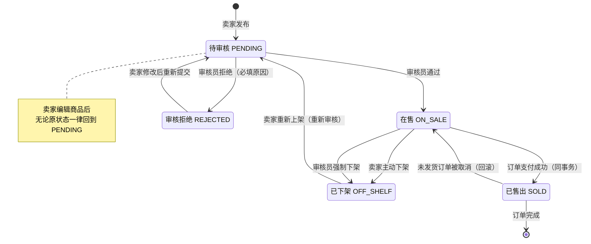
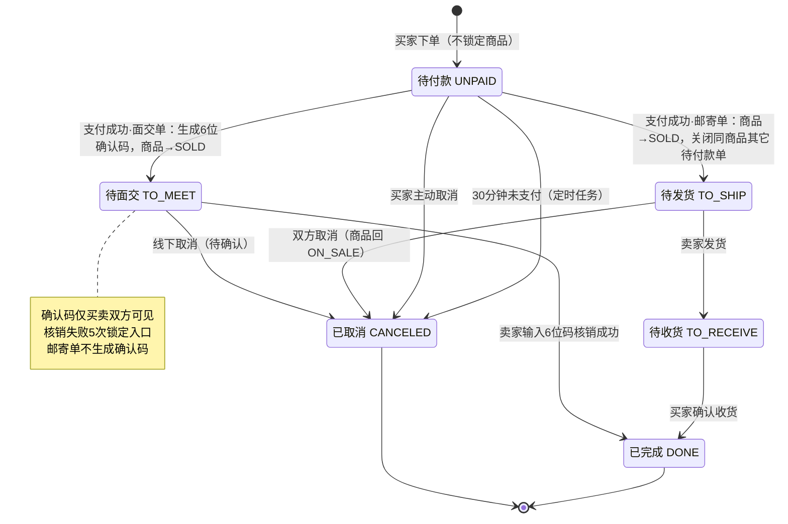

# Brix Campus Market 校园二手交易平台 — 产品需求文档（PRD）

## 0. 项目信息

| 项 | 内容 |
| --- | --- |
| 项目名称 | Brix Campus Market（`brix_campus_market`） |
| 文档类型 | 简单 PRD（不含量化竞品分析、不做市场定位推导） |
| 文档语言 | 中文 |
| 业务定位 | 严格校园版二手交易：用户归属「学校 + 校区」，商品按校区筛选，交易以校内面交为主、邮寄为备选 |
| 后端技术约束 | Spring Boot 3.x + Java 21 + Spring Security 6 + JWT + MyBatis-Plus + MySQL 9.6（本机服务 MySQL80，端口 3306，库 `brix_campus`） |
| 前端技术约束 | Vue3 + TypeScript + Vite + Element Plus + Pinia + Axios + ECharts，PC 端 1200px 定宽容器，不做移动端适配 |
| 实时通信 | WebSocket（Spring `@ServerEndpoint`/STOMP 简化实现），一对一私信 |
| AI 能力 | LangChain4j 智能体，**无 API Key 时自动降级为本地规则估价** |
| 文件存储 | 后端本地 `uploads/` 目录 + 静态资源映射，不使用对象存储 |
| 部署形态 | 本地裸机运行（后端 jar + 前端 dev/build），**不使用 Docker** |
| 参考原型 | `https://github.com/lihan1206/Brix_CampusSecond-HandPlatform`（**仅借鉴功能结构与页面骨架，代码全部重写**） |
| 规模基线 | 约 55 个接口 / 11 张表 / 19 个页面 |
| 原始需求复述 | 用 Spring Boot 3 + Vue3 重做校园二手交易平台，保留原型的浏览、发布、个人中心、下单与后台管理功能；新增面交确认码与 AI 智能估价两项差异化能力；补齐私信、评价、举报、三级角色后台；预置仿真种子数据以便完整演示 |

---

## 1. 产品目标与非目标

### 1.1 产品目标

| 编号 | 目标 | 判定方式 |
| --- | --- | --- |
| G1 | **核心交易闭环可完整跑通**：发布 → 浏览 → 下单 → 收银台支付 → 面交核销/发货收货 → 完成 → 评价 | 用种子数据在 5 分钟内走完一条面交单与一条邮寄单，全流程无阻断 |
| G2 | **用面交确认码解决校园"先付钱还是先给货"的信任难题**，并让线下验货与线上状态同步 | 面交订单支付后 100% 生成 6 位确认码，仅买卖双方可见，核销后订单直接变为已完成 |
| G3 | **降低发布门槛**：AI 估价与文案生成让用户一键得到建议价、标题、描述 | 发布页点一次按钮即可获得建议价（含区间/置信度/依据/风险提示）与可填入表单的标题描述；无 API Key 时同一结构返回 |

### 1.2 非目标（本期明确不做）

| 不做项 | 说明 |
| --- | --- |
| 真实支付对接 | 收银台"确认支付"为模拟支付，仅落库 `pay_method`/`pay_time`，不接微信/支付宝/银联 SDK |
| 第三方登录 | 无微信登录、无短信验证码、无 OAuth，仅账号 + 密码 |
| 多级评论 | 留言仅一级 + 对一级留言的单层回复，不做树状嵌套 |
| 推荐算法 | 首页排序仅"最新/价格升降/最热"，无个性化推荐 |
| 对象存储 / CDN | 图片只落本地磁盘 `uploads/` |
| Docker / 容器化 | 本地裸机启动 |
| 移动端适配 | 仅保证 PC 端 1200px 容器；不做响应式与 H5 |
| Redis / 缓存层 | 不使用任何外部缓存中间件 |
| 私信高级功能 | 不做表情包、图片消息、消息撤回；仅文本 + 未读数 + 打开会话即已读 |

---

## 2. 用户角色与权限矩阵

### 2.1 角色定义

| 角色 | 代码 | 说明 |
| --- | --- | --- |
| 游客 | `GUEST` | 未登录，仅可浏览 |
| 普通用户 | `USER` | 学生身份，既可买也可卖；包含发布、购买、私信、收藏、留言、评价、举报 |
| 审核员 | `REVIEWER` | 后台角色：商品审核、强制下架、举报处理 |
| 运营 | `OPERATOR` | 后台角色：数据大屏、用户管理（禁用/启用）、订单查询、分类管理 |

### 2.2 权限矩阵（✓ 允许 / ✗ 拒绝 / 条件允许）

| 功能 | GUEST | USER | REVIEWER | OPERATOR |
| --- | :---: | :---: | :---: | :---: |
| 浏览首页/商品列表/商品详情 | ✓ | ✓ | ✓ | ✓ |
| 注册 / 登录 | ✓ | ✗（已登录跳首页） | ✗ | ✗ |
| 发布 / 编辑 / 删除商品、上下架 | ✗ | ✓（仅本人商品） | ✗ | ✗ |
| 下单 / 收银台支付 / 取消订单 / 确认收货 | ✗ | ✓（不可买自己商品） | ✗ | ✗ |
| 面交确认码查看 | ✗ | ✓（仅该单买卖双方） | ✗ | ✗ |
| 面交确认码核销 | ✗ | ✓（仅该单卖家） | ✗ | ✗ |
| 收藏 / 留言 / 私信 | ✗ | ✓ | ✓ | ✓ |
| 评价（买家评卖家） | ✗ | ✓（仅本人已完成订单，每单一次） | ✗ | ✗ |
| 举报商品 | ✗ | ✓ | ✓ | ✓ |
| 个人资料 / 头像 / 改密码 | ✗ | ✓（仅本人） | ✓ | ✓ |
| 商品审核（通过/拒绝） | ✗ | ✗ | ✓ | ✗ |
| 强制下架 | ✗ | ✗ | ✓ | ✗ |
| 举报处理（下架/驳回） | ✗ | ✗ | ✓ | ✗ |
| 数据大屏 | ✗ | ✗ | ✗ | ✓ |
| 用户管理（禁用/启用） | ✗ | ✗ | ✗ | ✓ |
| 全平台订单查询 | ✗ | ✗ | ✗ | ✓ |
| 分类管理（增删改查） | ✗ | ✗ | ✗ | ✓ |
| 后台菜单渲染 | ✗ | ✗ | 按权限点渲染 | 按权限点渲染 |

**权限实现要求**：前端按角色渲染菜单仅为体验，**后端接口层必须独立校验**；`USER` 访问 `/api/admin/**` 一律返回 403；`REVIEWER` 访问运营专属接口同样返回 403。账号被禁用（`status = DISABLED`）后，登录返回 400 且已签发 Token 的请求一律 403。

---

## 3. 用户故事

> 优先级：**P0** 必须交付 / **P1** 应交付 / **P2** 可延后

### 3.1 游客

| 编号 | 用户故事 | 优先级 |
| --- | --- | --- |
| US-01 | 作为游客，我想在首页看到 Hero 大图 + 筛选卡 + 4 列商品格，以便快速判断这个平台卖什么、是否与我同校区 | P0 |
| US-02 | 作为游客，我想用关键词、分类、校区、价格区间筛选并排序商品，以便在几十件商品里快速找到想要的 | P0 |
| US-03 | 作为游客，我想看到商品详情（图片轮播、成色、交易方式、卖家信用），以便决定是否注册下单 | P0 |
| US-04 | 作为游客，我点击"我想要"时被引导到登录页，登录后回到原商品页，以便不丢失浏览上下文 | P1 |

### 3.2 买家（USER）

| 编号 | 用户故事 | 优先级 |
| --- | --- | --- |
| US-05 | 作为买家，我想对在售商品直接下单并在独立收银台页面看到订单号与金额，以便明确我在付哪一笔钱 | P0 |
| US-06 | 作为买家，我想在收银台选择微信/支付宝/银行卡并一键完成模拟支付，以便演示完整交易链路 | P0 |
| US-07 | 作为买家，我想在面交时向卖家出示 6 位确认码，以便验货后当场完成交易、避免"先付钱还是先给货"的争执 | P0 |
| US-08 | 作为买家，我想看到"待付款/待发货/待面交/待收货/已完成/已取消"的订单并可按状态筛选，以便知道我下一步该做什么 | P0 |
| US-09 | 作为买家，我想在订单完成后给卖家 1-5 星 + 文字 + 最多 3 张图的评价（也可不评），以便给后来者参考 | P1 |
| US-10 | 作为买家，我想收藏商品并在"我的收藏"里回看，以便比价后再决定 | P0 |
| US-11 | 作为买家，我想在商品详情页留言提问、并回复卖家的留言，以便确认成色与配件细节 | P0 |
| US-12 | 作为买家，我想私信卖家询问细节并看到未读数，以便不在公开留言区暴露议价 | P0 |

### 3.3 卖家（USER）

| 编号 | 用户故事 | 优先级 |
| --- | --- | --- |
| US-13 | 作为卖家，我想填写标题、描述、分类、价格、原价、成色、校区、交易方式、最多 9 张图后发布，以便把闲置挂上去 | P0 |
| US-14 | 作为卖家，我想在发布页点"AI 帮我定价"拿到建议价、价格区间、置信度、定价依据与风险提示，以便不因定价过高而无人问津 | P0 |
| US-15 | 作为卖家，我想一键生成标题与描述并填入表单，以便 10 秒内完成一件商品的文案 | P0 |
| US-16 | 作为卖家，我想在"我的商品"里看到每件商品的状态（待审核/在售/已下架/已售出/审核拒绝及原因）并可编辑、上下架、删除，以便管理我的货架 | P0 |
| US-17 | 作为卖家，我想在面交订单页输入买家口述的 6 位确认码完成核销，以便订单立即结算为已完成 | P0 |
| US-18 | 作为卖家，我想看到"我卖出的"订单并对待发货订单点"已发货"，以便推进邮寄单流程 | P0 |

### 3.4 审核员（REVIEWER）

| 编号 | 用户故事 | 优先级 |
| --- | --- | --- |
| US-19 | 作为审核员，我想看到待审核商品列表并逐条通过或拒绝（必须填写拒绝原因），以便拦住违规与虚假信息 | P0 |
| US-20 | 作为审核员，我想对已上架商品强制下架，以便处理用户举报的违规商品 | P0 |
| US-21 | 作为审核员，我想看到举报列表并选择"下架商品"或"驳回举报"，以便形成处理闭环 | P0 |

### 3.5 运营（OPERATOR）

| 编号 | 用户故事 | 优先级 |
| --- | --- | --- |
| US-22 | 作为运营，我想在数据大屏看到注册用户数、在售商品数、今日订单数、累计成交额、近 7 天订单趋势、分类分布、待审核列表，以便一眼掌握平台健康度 | P0 |
| US-23 | 作为运营，我想按用户名/昵称搜索用户并禁用或启用账号，以便处置恶意用户 | P0 |
| US-24 | 作为运营，我想按状态与关键词查询全平台订单，以便排查纠纷 | P0 |
| US-25 | 作为运营，我想增删改分类（名称、图标、排序），以便调整平台品类结构 | P0 |

### 3.6 系统（定时任务 / 平台规则）

| 编号 | 用户故事 | 优先级 |
| --- | --- | --- |
| US-26 | 作为系统，我要在下单 30 分钟未支付时自动关单，以便商品不会长期被无效订单占用 | P0 |
| US-27 | 作为系统，我要在支付事务内把商品置为已售出并关闭同一商品的其它待付款订单，以便同一件商品不会被卖两次 | P0 |
| US-28 | 作为系统，我要在买家支付成功后立即生成 6 位面交确认码，以便买卖双方线下有唯一凭据 | P0 |

---

## 4. 需求池

> 共 **69 条**需求条目（A 7 / B 9 / C 2 / D 3 / E 10 / F 4 / G 3 / H 2 / I 4 / J 4 / K 12 / N 9），对应后端接口约 **55 个**（部分条目为跨接口的业务规则/非功能约束）。验收标准均可通过接口调用或页面操作直接验证。

### 4.1 认证与用户

| 编号 | 模块 | 功能 | 优先级 | 验收标准 |
| --- | --- | --- | :---: | --- |
| A01 | 认证 | 注册 | P0 | 提交用户名/密码/昵称/学校/校区/手机号；用户名重复返回 400「用户名已存在」；密码长度 <6 返回 400；手机号非 11 位数字返回 400；注册成功返回 200 且新用户 `role=USER`、`status=NORMAL`，密码在库中为 BCrypt 密文 |
| A02 | 认证 | 登录（账号密码） | P0 | 正确账密返回 token + 用户信息（含 role）；密码错误返回 400「用户名或密码错误」（不区分账号是否存在）；`status=DISABLED` 返回 400「账号已被禁用」；token 为 JWT，有效期 24 小时 |
| A03 | 认证 | 获取当前用户 | P0 | 携带 token 请求返回 id/用户名/昵称/头像/学校/校区/角色/信用分；无 token 或 token 过期返回 401 |
| A04 | 认证 | 修改个人资料 | P0 | 可改昵称/学校/校区/手机号/简介；只允许改本人（id 取自 token，不接受请求体传 id）；改后再次查询 A03 返回新值 |
| A05 | 认证 | 修改密码 | P0 | 需提交旧密码，旧密码错误返回 400；新密码 <6 返回 400；成功后旧密码登录失败、新密码登录成功 |
| A06 | 认证 | 头像上传 | P1 | 上传 jpg/png/webp 且 ≤5MB 返回可访问 URL 并写入用户头像；传 .gif 或 >5MB 返回 400；上传后 A03 返回新头像地址 |
| A07 | 认证 | 退出登录 | P1 | 前端清除本地 token 并跳转登录页；退出后用旧 token 请求受保护接口仍返回 401（前端已不再携带） |

### 4.2 商品

| 编号 | 模块 | 功能 | 优先级 | 验收标准 |
| --- | --- | --- | :---: | --- |
| B01 | 商品 | 发布商品 | P0 | 必填标题/描述/分类/价格/成色/校区/交易方式；缺任一返回 400 并指明字段；图片 0-9 张，第 10 张返回 400；价格 ≤0 或 >99999.99 返回 400；发布成功状态为 `PENDING`（待审核），列表页不可见 |
| B02 | 商品 | 商品列表（分页 + 筛选 + 排序） | P0 | 仅返回 `ON_SALE` 商品；支持关键词（标题或描述模糊）、分类、校区、价格区间、sort=latest/price_asc/price_desc/hot；默认按最新排序；分页默认 10、最大 50；返回总数、页数、当前页数据 |
| B03 | 商品 | 商品详情 | P0 | 返回全部字段 + 图片列表 + 卖家昵称/信用分/校区；每次请求浏览量 +1（同一用户 10 分钟内重复访问不重复计数，用于演示数据稳定）；登录态返回 `isFavorite` |
| B04 | 商品 | 我的商品 | P0 | 返回本人全部状态商品（含待审核/审核拒绝），带状态文案与拒绝原因；分页默认 10 |
| B05 | 商品 | 编辑商品 | P0 | 仅本人可编辑，他人编辑返回 403；编辑后状态回到 `PENDING` 重新审核（`SOLD` 状态不允许编辑，返回 400） |
| B06 | 商品 | 删除商品 | P1 | 仅本人可删；`ON_SALE` 与 `PENDING` 可直接删（逻辑删除）；存在未完成订单的商品返回 400「有进行中的订单，无法删除」 |
| B07 | 商品 | 上架 / 下架 | P0 | 在售 → 已下架可立即生效；已下架 → 重新上架回到 `PENDING` 待审核；`SOLD` 不可操作，返回 400 |
| B08 | 商品 | 商品状态机约束 | P0 | 非法流转（如在售直接置为已售出、审核拒绝直接置为在售）返回 400；状态枚举仅 5 种：`PENDING/ON_SALE/OFF_SHELF/SOLD/REJECTED` |
| B09 | 商品 | 公开分类列表 | P0 | 无需登录返回全部分类（id、名称、图标、排序），按 sort 升序；最多 6 条种子数据 |

### 4.3 收藏

| 编号 | 模块 | 功能 | 优先级 | 验收标准 |
| --- | --- | --- | :---: | --- |
| C01 | 收藏 | 收藏 / 取消收藏（切换式） | P0 | 未收藏时调用变为已收藏，再次调用变为未收藏；返回最新收藏状态；同一用户重复收藏同一商品在库中只有一条记录 |
| C02 | 收藏 | 我的收藏列表 | P0 | 返回收藏商品（标题/首图/价格/状态/卖家），已售出或已下架商品仍展示但标记状态；支持取消收藏；分页默认 10 |

### 4.4 留言问答

| 编号 | 模块 | 功能 | 优先级 | 验收标准 |
| --- | --- | --- | :---: | --- |
| D01 | 留言 | 留言列表 | P0 | 按商品返回一级留言，每条一级留言下挂其回复列表（按时间升序）；无需登录可查看；分页默认 10 |
| D02 | 留言 | 发表留言 / 回复一楼 | P0 | 内容 1-500 字，空内容返回 400；`parentId` 为空即一级留言；`parentId` 指向的留言必须属于同一商品且本身为一级留言，否则返回 400；不支持三级嵌套 |
| D03 | 留言 | 删除自己的留言 | P1 | 仅作者本人可删，他人返回 403；删除一级留言时其下回复一并逻辑删除 |

### 4.5 订单与交易

| 编号 | 模块 | 功能 | 优先级 | 验收标准 |
| --- | --- | --- | :---: | --- |
| E01 | 订单 | 下单 | P0 | 校验商品必须 `ON_SALE`（否则 400「商品不可购买」）；买家不能买自己商品（400）；同一买家对同一商品存在未取消订单时返回 400「请勿重复下单」；成功生成 `UNPAID` 订单并成为收银台跳转目标 |
| E02 | 订单 | 收银台支付（模拟） | P0 | 提交 `payMethod=WECHAT/ALIPAY/BANK`，非枚举值返回 400；支付成功后状态 `UNPAID → TO_SHIP`（邮寄单）或 `TO_MEET`（面交单）；同一事务内写入 `pay_method`、`pay_time`、商品 `ON_SALE → SOLD`、关闭同商品其它 `UNPAID` 订单；重复支付已支付订单返回 400 |
| E03 | 订单 | 卖家发货 | P0 | 仅该单卖家可操作且状态必须为 `TO_SHIP`，否则 400/403；成功后 `TO_SHIP → TO_RECEIVE` 并记录发货时间 |
| E04 | 订单 | 买家确认收货 | P0 | 仅该单买家可操作且状态为 `TO_RECEIVE`；成功后 `→ DONE` 并写入完成时间 |
| E05 | 订单 | 取消订单 | P1 | `UNPAID` 买家可取消；`TO_SHIP` 买卖双方均可取消；`TO_RECEIVE`/`TO_MEET`/`DONE` 不可取消（400）；取消后订单 `CANCELED`，若商品已 `SOLD` 则回滚为 `ON_SALE` |
| E06 | 订单 | 30 分钟未付款自动关单 | P0 | 定时任务每 1 分钟扫描 `UNPAID` 且 `created_at` 超 30 分钟的订单，置为 `CANCELED` 并写 `close_reason=TIMEOUT`；手动把某订单 `created_at` 改到 31 分钟前，1 分钟内状态变更 |
| E07 | 订单 | 买家订单列表 | P0 | 返回本人作为买家的订单，支持 status 筛选（全部/待付款/待发货/待面交/待收货/已完成/已取消）；列出商品首图标题、金额、对方昵称、当前状态与可用操作 |
| E08 | 订单 | 卖家订单列表 | P0 | 返回本人作为卖家的订单，按状态筛选；`TO_SHIP` 显示「发货」按钮，`TO_MEET` 显示「核销确认码」入口 |
| E09 | 订单 | 订单详情 | P0 | 返回订单号、商品快照（标题/首图/单价）、金额、交易方式、支付方式、时间线、买卖双方昵称与联系方式、面交地址（校区/宿舍楼）；非买卖双方访问返回 403 |
| E10 | 订单 | 并发下单防超卖 | P0 | 两个用户对同一商品同时支付，仅一个成功，另一个返回 400「商品已被抢先购买」；商品最终有且仅有一条成功订单，`SOLD` 状态只由该订单产生 |

### 4.6 面交确认码（创新点 A）

| 编号 | 模块 | 功能 | 优先级 | 验收标准 |
| --- | --- | --- | :---: | --- |
| F01 | 面交码 | 生成 6 位确认码 | P0 | 面交类订单支付成功时同事务生成 6 位纯数字码（可含前导 0），存于订单表；同一订单码固定不变；邮寄单不生成 |
| F02 | 面交码 | 查看确认码（仅买卖双方） | P0 | 买家与卖家在订单详情可看到完整 6 位码；第三方用户请求返回 403；未支付订单返回 400「尚未生成确认码」 |
| F03 | 面交码 | 卖家核销 | P0 | 卖家输入正确码：订单 `TO_MEET → DONE` 并记录核销时间；输入错误返回 400「确认码错误，剩余 N 次机会」；买家自己核销返回 403；非 `TO_MEET` 订单核销返回 400 |
| F04 | 面交码 | 核销失败 5 次锁定 | P0 | 同一订单累计失败 5 次后，后续核销一律返回 400「该订单核销已锁定，请联系运营处理」，即使输入正确码也不予通过；计数持久化，重启服务后仍有效 |

### 4.7 评价与信用

| 编号 | 模块 | 功能 | 优先级 | 验收标准 |
| --- | --- | --- | :---: | --- |
| G01 | 评价 | 提交评价（可选） | P1 | 仅买家可评卖家，订单必须为 `DONE`，每单最多一次（重复提交 400）；评分 1-5 整数，越界返回 400；文字 0-500 字、图片 0-3 张，全空时仍可提交纯星级评价 |
| G02 | 评价 | 卖家评价列表 | P1 | 返回某卖家的评价（评分、文字、图片、评价人昵称脱敏、时间）与平均分、评价总数；无评价返回空列表而非 404 |
| G03 | 评价 | 信用分累加 | P1 | 4-5 星 +2、3 星 +1、1-2 星 -1，初始 100 分，范围限制在 0-200；商品详情与订单详情展示更新后的信用分 |

### 4.8 举报

| 编号 | 模块 | 功能 | 优先级 | 验收标准 |
| --- | --- | --- | :---: | --- |
| H01 | 举报 | 提交举报 | P1 | 原因必须为枚举（虚假信息/违禁物品/价格欺诈/盗图/其他）之一，否则 400；说明 0-200 字；同一用户对同一商品仅能有 1 条 `PENDING` 举报（重复返回 400）；不能举报自己商品（400） |
| H02 | 举报 | 举报列表与处理（REVIEWER） | P0 | 列表按状态筛选并分页；处理动作仅 `OFFLINE`（下架商品，商品置 `OFF_SHELF`）与 `REJECT`（驳回），处理后举报置为已处理并记录处理人与时间；`USER` 调用返回 403 |

### 4.9 私信（WebSocket 简化版）

| 编号 | 模块 | 功能 | 优先级 | 验收标准 |
| --- | --- | --- | :---: | --- |
| I01 | 私信 | 发送消息 | P0 | 通过 WebSocket 连接（携带 token 鉴权）发送文本，内容 1-500 字；发送成功后落库并实时推给在线接收方；接收方离线则仅落库；不能发给自己（400） |
| I02 | 私信 | 会话列表 | P0 | 不建会话表，按"对方用户 ID"聚合返回：对方昵称/头像、最后一条消息、最后时间、未读数，按最后时间倒序 |
| I03 | 私信 | 历史消息 | P0 | 按对方 ID 返回双向消息，时间升序，分页默认 20、最大 50；只能查看与自己相关的消息 |
| I04 | 私信 | 未读数与已读 | P1 | 全局未读总数 = 所有对方发来且 `is_read=0` 的条数；打开某会话即把该会话收到的消息置为已读，未读数随之减为 0 |

### 4.10 AI 智能估价与文案（创新点 B）

| 编号 | 模块 | 功能 | 优先级 | 验收标准 |
| --- | --- | --- | :---: | --- |
| J01 | AI | 智能估价 | P0 | 入参分类 + 品牌型号 + 成色 + 购入时间（可选原价）；返回 `suggestPrice`、`priceRange{min,max}`、`confidence`(0-1)、`reasons[]`（≥2 条，引用同款成交/在售数据，如「同款 3 笔成交均价 ¥1250」）、`riskTips[]`；10 秒内返回，超时走降级 |
| J02 | AI | 一键生成标题与描述 | P0 | 入参同上，返回 `title`（≤40 字）、`description`（100-300 字）、`tags[]`（3-5 个）；前端「填入表单」把三者写入对应字段，用户可再编辑 |
| J03 | AI | 无 API Key 降级 | P0 | 未配置 Key 时同一接口返回**同结构**数据，`confidence` ≤0.6 且 `reasons` 中含「基于本地规则估算，仅供参考」；前端无报错、无字段缺失，无需任何额外判断 |
| J04 | AI | 调用频率限制 | P0 | 每用户每天 20 次（自然日，按 user_id + 日期计数）；第 21 次返回 429「今日 AI 次数已用完」；估价与文案共用同一计数池 |

### 4.11 管理端

| 编号 | 模块 | 功能 | 优先级 | 验收标准 |
| --- | --- | --- | :---: | --- |
| K01 | 后台 | 角色鉴权与菜单渲染 | P0 | 登录后按 role 返回可用菜单；`USER` 登录后台路由被拦截回登录页；`USER` 直接请求 `/api/admin/**` 返回 403；`REVIEWER` 请求运营接口返回 403 |
| K02 | 后台 | 数据大屏核心指标 | P0 | 返回注册用户数、在售商品数、今日订单数、累计成交额（仅统计已支付及之后状态订单）四项；数值与库内实际数据一致 |
| K03 | 后台 | 近 7 天订单趋势 | P0 | 返回含今天在内的 7 天，每天日期 + 订单数；无订单的日期补 0，X 轴连续不断点 |
| K04 | 后台 | 分类分布 + 待审核列表 | P0 | 饼图数据为各分类在售商品数（含 0 的分类可选剔除）；同时返回待审核商品 Top10（标题、卖家、提交时间） |
| K05 | 后台 | 用户管理列表 | P0 | 支持按用户名/昵称关键词搜索、按角色与状态筛选、分页默认 10；返回角色与状态文案 |
| K06 | 后台 | 用户禁用 / 启用 | P0 | 禁用后该用户立即无法登录，已登录请求返回 403；不能禁用自己（400）；操作记录操作人与时间 |
| K07 | 后台 | 商品审核列表 | P0 | 返回 `PENDING` 商品，含图片、卖家、价格、分类、提交时间，按提交时间升序（先到先审） |
| K08 | 后台 | 审核通过 | P0 | 单条或批量通过，`PENDING → ON_SALE`；通过后商品出现在前台列表 |
| K09 | 后台 | 审核拒绝 | P0 | 拒绝原因必填（1-200 字），空原因返回 400；`PENDING → REJECTED` 并写入原因；卖家「我的商品」可见原因并可改后重提 |
| K10 | 后台 | 强制下架 | P0 | 任意 `ON_SALE` 商品可被 `REVIEWER` 置为 `OFF_SHELF` 并记录原因；该操作不受商品归属限制；已存在进行中订单时仍可下架但提示 |
| K11 | 后台 | 全平台订单查询 | P0 | 支持按状态、订单号/商品标题关键词、买卖家用户名筛选，分页默认 10；返回买卖双方、金额、状态、支付方式 |
| K12 | 后台 | 分类管理 | P0 | 新增（名称必填且不重复）、编辑（名称/图标/排序）、删除；删除时该分类下存在商品则返回 400「该分类下仍有商品」；排序值参与前台分类展示顺序 |

### 4.12 非功能需求

| 编号 | 模块 | 功能 | 优先级 | 验收标准 |
| --- | --- | --- | :---: | --- |
| N01 | 通用 | 统一响应体 | P0 | 所有接口返回 `{code, message, data}`；成功 `code=200`；业务失败 `code=400`；未登录 401；无权限 403；限流 429；服务异常 500 且不暴露堆栈 |
| N02 | 通用 | 全局异常与参数校验 | P0 | 参数校验失败返回 400 + 具体字段提示（如「价格不能为空」）；路径参数非法（如 id 传 abc）返回 400 而非 500；未捕获异常统一由全局处理器兜底 |
| N03 | 通用 | JWT 无状态鉴权 | P0 | 服务端不存 session；token 放 `Authorization: Bearer`；篡改 payload 的 token 返回 401 |
| N04 | 通用 | 密码安全 | P0 | 库中密码列全部为 BCrypt `$2a$` 密文，任何接口响应与日志均不出现明文密码 |
| N05 | 通用 | 分页规范 | P0 | 列表接口统一参数 `page`（从 1 开始）、`size`；未传 size 默认 10；size>50 自动截断为 50 |
| N06 | 通用 | 图片上传校验 | P0 | 仅 jpg/jpeg/png/webp；单张 ≤5MB；商品 ≤9 张、评价 ≤3 张；超限或类型不符返回 400 |
| N07 | 通用 | 本地静态资源映射 | P0 | 上传文件落 `uploads/`，通过 `/uploads/**` 直接访问返回 200 与原图一致；重启服务后旧图片仍可访问 |
| N08 | 通用 | 种子数据 | P0 | 启动后存在 8 个用户（1 普通测试号 + 1 审核员 + 1 运营 + 5 普通卖家）、6 个分类、36 件商品；商品覆盖在售/待审核/已售出/已下架四种状态且价格符合真实行情（如 iPad 9 代 64G ¥1280、AirPods Pro 2 ¥890、红米 27 寸 2K ¥420、张宇考研数学全套 ¥85）；测试号可直接登录演示 |
| N09 | 通用 | PC 端布局 | P1 | 浏览器宽度 ≥1280px 时页面内容居中于 1200px 容器，无横向滚动条；不做移动端适配 |

---

## 5. 核心流程图

### 5.1 商品状态机

### 5.2 订单状态机（含面交确认码分支与超时分支）

---

## 6. 页面清单（19 页）

> 布局：`layout/` 双层结构 —— `BasicLayout`（用户端：顶部导航 + 搜索框 + 用户菜单）与 `AdminLayout`（后台：侧边菜单 + 顶栏）。页面统一放 `pages/`。

| # | 页面名 | 路由 | 主要元素 | 交互要点 |
| --- | --- | --- | --- | --- |
| 1 | 登录 | `/login` | 账号、密码、登录按钮、去注册链接 | 提交后存 token 与用户信息，按角色跳首页或后台；失败用 ElMessage 提示；已登录访问重定向首页 |
| 2 | 注册 | `/register` | 用户名、密码、昵称、学校、校区、手机号 | 前端校验后提交；成功后自动登录并跳首页；用户名重复就地报错 |
| 3 | 首页 | `/` | Hero 大图、筛选卡（关键词/分类/校区/价格区间/排序）、4 列商品网格、分页器 | 筛选变化即请求列表并把条件写入 URL query；空结果展示空态插图 + 「重置筛选」；卡片 hover 上浮 |
| 4 | 商品详情 | `/items/:id` | 左侧图片轮播（≤9 张）、右侧标题/价格/原价/成色/浏览量、卖家卡片（头像/昵称/信用分/校区）、交易方式、留言区、收藏/我想要/私信/举报按钮 | 进页面浏览 +1；未登录点「我想要」跳登录并带 `redirect`；已售出时按钮置灰显示「已售出」；留言支持对一楼回复、可删自己的 |
| 5 | 发布商品 | `/publish`（含编辑态 `/publish?id=x`） | 表单（标题/描述/分类/价格/原价/成色/校区/交易方式/联系方式）、多图上传（≤9，可拖拽排序、可删除）、AI 面板（品牌型号、购入时间、「AI 帮我定价」「生成文案」）、提交按钮 | 点 AI 定价弹出结果卡片（建议价/区间/置信度进度条/依据列表/风险提示），点「使用此价」回填；文案生成后「填入表单」覆盖标题与描述；提交成功跳「我的商品」并提示「已提交审核」 |
| 6 | 我的商品 | `/my/items` | 状态 Tab（全部/在售/待审核/已下架/已售出/审核拒绝）、商品卡片列表、操作按钮组 | Tab 切换带参请求；拒绝原因以气泡展示；编辑跳 `/publish?id=`；删除二次确认；下架/上架即时刷新当前行状态 |
| 7 | 我的收藏 | `/my/favorites` | 收藏商品网格、取消收藏按钮、商品状态角标 | 取消收藏后从列表移除并提示可撤销；已售出商品卡片置灰但仍可点进详情 |
| 8 | 我的订单 | `/my/orders` | 买家/卖家视角切换、状态 Tab、订单卡片（商品首图、标题、金额、对方、状态、操作按钮） | 待付款显示「去支付/取消」，待发货（卖家）显示「发货」，待面交显示「查看确认码」（买家）与「核销」（卖家），待收货显示「确认收货」，已完成显示「评价」 |
| 9 | 订单详情 | `/orders/:id` | 状态头部、订单号与时间线、商品快照、金额与支付方式、买卖双方信息与联系方式、面交地点、确认码区域、操作按钮 | 面交单一进页面即展示 6 位码（大字号、可复制）；卖家侧展示核销输入框，失败提示剩余次数，锁定后输入框禁用并提示联系运营 |
| 10 | 收银台 | `/checkout/:orderId` | 订单号、应付金额（大字号）、支付方式单选（微信/支付宝/银行卡）、确认支付按钮、倒计时（剩余支付时间） | 点确认支付后按钮 loading 约 1 秒 → 成功动画 → 弹「支付成功」→ 跳订单详情；倒计时归零提示订单已关闭并跳回订单列表 |
| 11 | 个人中心 | `/profile` | 头像上传、昵称/学校/校区/手机号/简介表单、修改密码表单、我的数据（发布数/在售数/卖出数/信用分） | 头像上传即时预览；保存后刷新顶部导航昵称；改密码成功后提示并保留登录态 |
| 12 | 私信 | `/messages` | 左侧会话列表（头像、昵称、最后消息、时间、未读红点）、右侧消息气泡区、底部输入框 | 进页面顶部未读数清零；WebSocket 实时接收，收到消息若不在当前会话则未读 +1；回车发送 |
| 13 | 后台登录 | `/admin/login` | 账号、密码、登录按钮 | 仅 `REVIEWER/OPERATOR` 可进入，`USER` 登录提示「无后台权限」并拒绝；成功后按角色渲染菜单 |
| 14 | 数据大屏 | `/admin/dashboard` | 4 张指标卡（注册用户/在售商品/今日订单/累计成交额）、近 7 天订单趋势折线图、分类分布饼图、待审核商品列表 | ECharts 自适应容器宽度；待审核列表项可一键跳商品审核页；数据为空时图表显示「暂无数据」 |
| 15 | 用户管理 | `/admin/users` | 搜索框（用户名/昵称）、角色与状态筛选、表格（ID/用户名/昵称/学校/角色/信用分/状态/注册时间）、禁用启用开关 | 禁用需二次确认；禁用自己时按钮置灰；操作后行状态即时更新 |
| 16 | 商品审核 | `/admin/items` | 待审核商品表格（缩略图、标题、卖家、分类、价格、提交时间）、行内「通过/拒绝」、批量通过、拒绝原因弹窗 | 拒绝必须填原因，未填禁用提交按钮；审核后行从列表移除；支持预览图片大图 |
| 17 | 订单管理 | `/admin/orders` | 状态筛选、关键词搜索、表格（订单号/商品/买家/卖家/金额/支付方式/状态/时间）、详情抽屉 | 抽屉展示完整时间线；仅 `OPERATOR` 可进入，侧边菜单同样隐藏 |
| 18 | 分类管理 | `/admin/categories` | 表格（图标、名称、排序、商品数）、新增/编辑弹窗、删除按钮 | 删除有商品分类时报错提示；排序值可编辑并即时影响前台顺序 |
| 19 | 举报处理 | `/admin/reports` | 状态 Tab（待处理/已处理）、表格（商品、举报人、原因、说明、时间）、处理弹窗（下架商品/驳回举报） | 处理后从待处理列表移除并可在已处理 Tab 查到处理人；点商品标题可跳前台详情新窗口打开 |

---

## 7. 关键业务规则

### 7.1 定价与字段边界

| 规则项 | 约束 |
| --- | --- |
| 商品价格 | `0 < price ≤ 99999.99`，最多 2 位小数 |
| 原价 | 可选；填写时必须 `≥ 现价`，否则 400 |
| 成色枚举 | `BRAND_NEW` 全新 / `LIKE_NEW` 几乎全新 / `LIGHT_USE` 轻微使用 / `HEAVY_USE` 明显使用 |
| 交易方式 | `MEET` 面交 / `SHIP` 邮寄 / `BOTH` 都可；下单时按商品方式决定订单分支（`BOTH` 由买家在下单页选择） |
| 图片数量 | 商品 0-9 张；评价 0-3 张；单张 ≤5MB，仅 jpg/jpeg/png/webp |
| 文本长度 | 标题 ≤40 字、描述 ≤2000 字、留言/私信/评价文字 ≤500 字、拒绝原因 ≤200 字、举报说明 ≤200 字 |
| AI 建议价 | 结果裁剪到 `[1, 99999]` 且区间 `min ≤ suggestPrice ≤ max`；`0 ≤ confidence ≤ 1` |
| 信用分 | 初始 100，范围 `[0, 200]`；4-5 星 +2、3 星 +1、1-2 星 -1 |

### 7.2 时间与超时规则

| 规则 | 参数 |
| --- | --- |
| 待付款超时关单 | 下单后 **30 分钟**未支付 → `CANCELED`，`close_reason=TIMEOUT`；定时任务扫描间隔 1 分钟 |
| JWT 有效期 | 24 小时，过期需重新登录 |
| 面交核销锁定 | 同一订单累计失败 **5 次** 后永久锁定核销入口 |
| 浏览量防刷 | 同一用户对同一商品 10 分钟内重复访问只计 1 次 |
| AI 计数周期 | 按自然日（`00:00` 重置） |
| 收银台倒计时 | 前端按下单时间 + 30 分钟计算，归零即引导离开 |

### 7.3 并发与一致性规则

| 规则 | 要求 |
| --- | --- |
| 下单不锁商品 | 下单仅生成 `UNPAID` 订单，商品仍为 `ON_SALE`，允许多人同时下单 |
| 支付时抢占 | 支付事务内对商品行加锁（行锁或乐观锁 version），校验商品仍为 `ON_SALE`；失败方返回「商品已被抢先购买」 |
| 支付事务原子性 | 「订单状态更新 + `pay_method`/`pay_time` 写入 + 商品 `SOLD` + 关闭同商品其它 `UNPAID` 单 + 生成面交确认码」必须在同一事务内完成 |
| 取消回滚 | 商品处于 `SOLD` 且无其它有效订单时，取消订单须把商品回滚为 `ON_SALE` |
| 评价唯一 | 同一订单只允许一条评价，靠订单唯一索引兜底 |

### 7.4 权限边界

| 边界 | 要求 |
| --- | --- |
| 数据归属 | 商品编辑/删除、订单操作、留言删除、资料修改一律以 token 中的用户 id 为准，忽略请求体传入的 userId |
| 订单可见性 | 订单详情仅该单买卖双方 + 后台角色可见；面交确认码仅买卖双方可见 |
| 自交易禁止 | 不能购买自己发布的商品、不能给自己发私信、不能举报自己商品 |
| 后台隔离 | `/api/admin/**` 全部经角色校验；审核员与运营权限点互不越界 |
| 禁用账号 | 禁用后登录失败、已签发 token 的请求返回 403（可在过滤器中查用户状态） |

### 7.5 限流规则

| 对象 | 限制 | 超限表现 |
| --- | --- | --- |
| AI 估价 + 文案 | 每用户每天 20 次（共用计数池） | 429「今日 AI 次数已用完」 |
| 面交核销 | 每订单 5 次失败 | 锁定入口，返回 400 提示联系运营 |
| 图片上传 | 单次请求 ≤9 张 | 400 |
| 列表分页 | size 最大 50 | 自动截断为 50 |

### 7.6 降级规则

| 场景 | 降级策略 |
| --- | --- |
| 未配置 AI API Key | 走本地规则估价：`建议价 = 品类基准价 × 成色系数 × 时间折损`；成色系数 全新 1.0 / 几乎全新 0.85 / 轻微使用 0.70 / 明显使用 0.55；时间折损每满 12 个月 -10%，累计最多 -50%，最低不低于 20%；返回结构与在线模式完全一致 |
| AI 调用超时（>10s）或异常 | 记录日志后自动转本地规则估价，接口仍返回 200，`confidence ≤0.6` 且 `reasons` 标注「基于本地规则估算，仅供参考」 |
| WebSocket 断连 | 前端显示「连接已断开，正在重连」，3 秒后自动重连；断连期间消息依赖历史消息接口补齐 |

---

## 8. 待确认问题

| # | 问题 | 影响范围 | 当前处理 |
| --- | --- | --- | --- |
| 1 | 面交单在 `TO_MEET` 状态下的取消路径未定义：买家已付款但未验货，双方线下谈崩后应该走「买家申请取消」还是「卖家发起退款」？ | 订单状态机、取消权限 | 本期按**双方均可取消并回滚商品为在售**实现，PRD 图中该分支标注为待确认；若确认需要「申请-审批」两步，需新增 1 个接口与 1 个状态 |
| 2 | 核销锁定（失败 5 次）后的兜底路径未定义：由运营在后台手工把订单置为已完成，还是走取消流程？ | 后台订单管理 | 本期仅锁定入口并提示「联系运营」，后台不提供手工改单状态能力 |
| 3 | `BOTH` 交易方式的商品，下单页由买家选择面交/邮寄——邮寄是否需要填写收货地址？二期若无地址簿，收货信息记在何处？ | 订单字段、下单页 | 本期邮寄单在订单中以「买家资料中的校区 + 备注」占位，不建地址表 |
| 4 | 卖家信用分 1-2 星扣分是否需要申诉/撤销机制？ | 评价与信用 | 本期不做申诉，扣分即时生效 |
| 5 | 私信是否限制「只能与有过商品往来的用户聊天」以防骚扰？ | 私信 | 本期不限制，任意登录用户可发起会话 |
| 6 | 数据大屏「累计成交额」是否包含已取消订单的退款？ | 统计口径 | 本期仅统计 `TO_SHIP/TO_RECEIVE/TO_MEET/DONE` 状态的订单金额，取消单不计入 |

---

**文档版本**：v1.0（需求定稿）
**下一步**：由架构师基于第 4/5/7 节输出技术方案、表结构与接口清单（11 张表 / 约 55 接口）。
